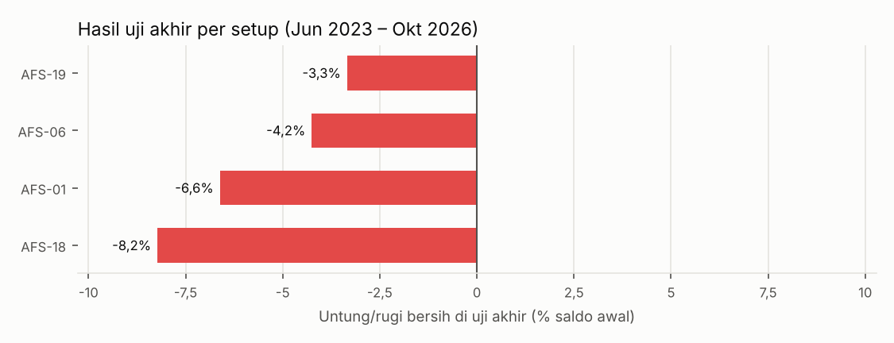
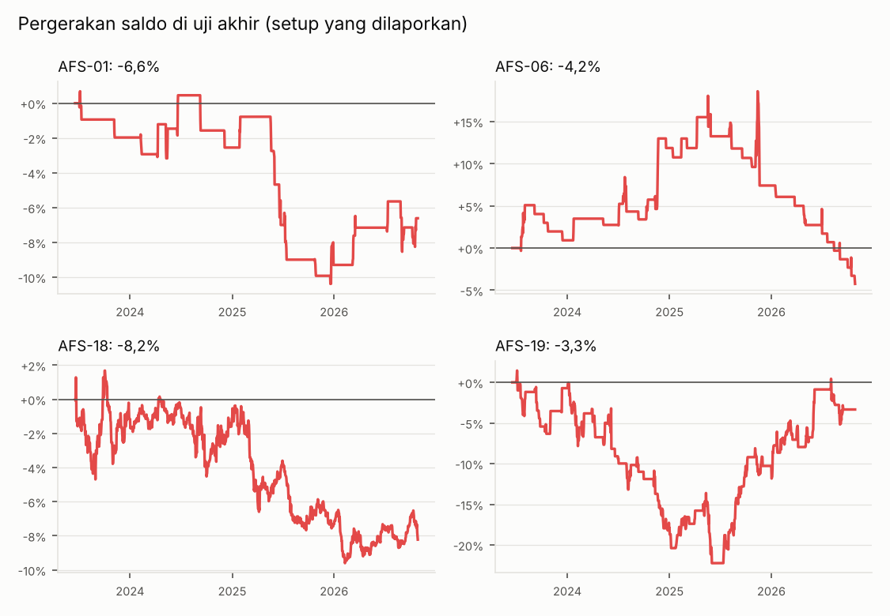

# Laporan backtest bot forex (EURUSD & XAUUSD)

Laporan ini dibuat otomatis oleh `scripts/make_report.py` dari hasil `scripts/run_backtest.py`. Semua aturan mengikuti [rulebook](../rulebook/README.md): aturan global G-01 – G-17, definisi D-01 – D-12, dan filter waktu di [07](../rulebook/07-filter-waktu.md).

## Jawaban singkat

1. **Untung atau rugi?** Hampir semua **rugi setelah biaya**. Dengan angka asli mentor (nilai awal), hanya 7 dari 30 setup yang untung di data 2010–2020, dan hanya 2 yang untung di data 2010–2020 **dan** 2020–2023 (ICH-01, AFS-04).
2. **Drawdown terburuk?** Bervariasi per setup (tabel di bawah). Yang paling dalam: AFS-19 94,9% di data 2010–2020 (versi mentor). Setup prioritas 1: PLN-01 25,8%; ICH-01 14,6%; ICH-02 46,3%; ICH-03 11,5%.
3. **Hasil di data yang tidak dipakai saat menyusun strategi (uji akhir, Jun 2023 – Okt 2026)?** Hanya 4 setup yang lolos syarat sampai ke sana, dan **semuanya rugi**: AFS-01 -6,6% (drawdown 11,5%, 36 transaksi); AFS-06 -4,2% (drawdown 20,7%, 36 transaksi); AFS-18 -8,2% (drawdown 11,3%, 33 transaksi); AFS-19 -3,3% (drawdown 23,9%, 98 transaksi). Setup lain tidak diuji akhir karena sudah gagal di data penyusunan/pemilihan (aturan G-17).
4. **Layak lanjut?** **Belum ada.** Pola N dan Ichimoku Rafał (prioritas 1) tidak lolos, dan setup mentor saham–kripto di forex (prioritas 2) juga tidak lolos. Bot sebaiknya **tidak** dijalankan dengan uang sungguhan.
5. **Filter Astronacci?** Lihat bagian Filter Astronacci: tanggal kandidat memang sedikit lebih sering jadi titik balik, tetapi menyalakan filter tidak membuat satu setup pun lolos.

## Ringkasan dalam bahasa sederhana

- **Data:** candle 5 menit EURUSD dan XAUUSD sejak 2010, dibagi menurut tanggal: **penyusunan** 2010-01-04 – 2020-02-07, **pemilihan** 2020-02-07 – 2023-06-19, **uji akhir** 2023-06-19 – 2026-10-29. Uji akhir adalah "data yang tidak dipakai saat menyusun strategi": dijalankan sekali setelah semua pilihan dikunci.
- **Biaya ikut dihitung:** spread EURUSD 1,4 pip, emas minimal 0,30 USD (melebar 0,015% dari harga), dan swap menginap. Saldo awal tiap bagian data USD 100 ribu, risiko 1% per transaksi (scalping 0,5%).
- **30 setup diuji.** 4 sampai ke uji akhir; **0 lolos** (untung bersih setelah biaya dengan minimal 30 transaksi di uji akhir). Sisanya "belum bisa dinilai" (gagal syarat di data penyusunan/pemilihan) atau "tidak lolos".

### Setup mana yang layak lanjut (sesuai urutan prioritas Anda)

**Prioritas 1 — setup forex (Pola N, Ichimoku Rafał): tidak ada yang lolos.**

- **PLN-01** (Pola N (impuls → koreksi sempit → tembus)): **belum bisa dinilai**. Versi mentor (nilai awal): data penyusunan -19,8% dari 128 transaksi (drawdown terburuk 25,8%), data pemilihan -8,3% dari 36 transaksi (drawdown 11,6%). Semua 7 varian di data pemilihan: -26,7% s.d. -1,0%. Alasan: semua varian rugi di data penyusunan atau pemilihan.
- **ICH-01** (Ichimoku tren penuh (harga, Tenkan–Kijun, Kumo, Chikou), bias W1 & D1): **belum bisa dinilai**. Versi mentor (nilai awal): data penyusunan +1,9% dari 81 transaksi (drawdown terburuk 14,6%), data pemilihan +6,5% dari 24 transaksi (drawdown 5,6%). Semua 5 varian di data pemilihan: -0,8% s.d. +9,5%. Alasan: varian yang untung di kedua bagian transaksinya < 30; varian yang transaksinya cukup rugi di salah satu bagian.
- **ICH-02** (Ichimoku retest Kijun (arah D1, entry H4)): **belum bisa dinilai**. Versi mentor (nilai awal): data penyusunan -44,4% dari 339 transaksi (drawdown terburuk 46,3%), data pemilihan +3,4% dari 107 transaksi (drawdown 8,9%). Semua 5 varian di data pemilihan: -0,8% s.d. +19,6%. Alasan: semua varian rugi di data penyusunan atau pemilihan.
- **ICH-03** (Ichimoku pullback ke Tenkan dalam tren kuat (D1)): **belum bisa dinilai**. Versi mentor (nilai awal): data penyusunan -8,1% dari 24 transaksi (drawdown terburuk 11,5%), data pemilihan +6,2% dari 15 transaksi (drawdown 4,4%). Semua 5 varian di data pemilihan: -0,7% s.d. +6,2%. Alasan: transaksi terlalu sedikit: < 30 di data pemilihan di semua varian.

**Prioritas 2 — setup mentor saham–kripto di forex: juga tidak ada yang lolos.** Belum ada setup yang layak dipakai dengan uang sungguhan. Lihat bagian "Langkah berikutnya".

Setup prioritas 2 yang sampai ke uji akhir (lolos syarat di data penyusunan & pemilihan), tetapi rugi di uji akhir:

- **AFS-01** (Technical Research 5 tahap, versi swing (D1 / H4 / M15)): **tidak lolos**. Versi mentor (nilai awal): data penyusunan -5,1% dari 176 transaksi (drawdown terburuk 27,1%), data pemilihan +3,6% dari 74 transaksi (drawdown 16,6%). Semua 5 varian di data pemilihan: -4,8% s.d. +5,8%. **Uji akhir:** -6,6% dari 36 transaksi, drawdown terburuk 11,5%.
- **AFS-06** (Stop hunt + break of structure): **tidak lolos**. Versi mentor (nilai awal): data penyusunan -10,8% dari 80 transaksi (drawdown terburuk 26,1%), data pemilihan +5,8% dari 39 transaksi (drawdown 11,5%). Semua 10 varian di data pemilihan: -2,0% s.d. +14,0%. **Uji akhir:** -4,2% dari 36 transaksi, drawdown terburuk 20,7%.
- **AFS-18** (Konfirmasi Chaikin Money Flow (breakout & divergensi)): **tidak lolos**. Versi mentor (nilai awal): data penyusunan +0,7% dari 24 transaksi (drawdown terburuk 7,3%), data pemilihan -1,2% dari 18 transaksi (drawdown 6,9%). Semua 6 varian di data pemilihan: -14,5% s.d. +12,5%. **Uji akhir:** -8,2% dari 33 transaksi, drawdown terburuk 11,3%.
- **AFS-19** (Pantulan POC volume profile): **tidak lolos**. Versi mentor (nilai awal): data penyusunan -94,6% dari 1964 transaksi (drawdown terburuk 94,9%), data pemilihan -45,4% dari 713 transaksi (drawdown 48,7%). Semua 6 varian di data pemilihan: -45,4% s.d. +20,5%. **Uji akhir:** -3,3% dari 98 transaksi, drawdown terburuk 23,9%.

Lolos backtest belum berarti siap dipakai dengan uang sungguhan: rulebook (G-14, Q-03) mewajibkan uji di **akun demo** dulu.

### Kenapa hampir semua setup rugi?

Sebagai pembanding, mesin backtest yang sama dijalankan dengan **arah acak** (SL = TP = 1 × ATR). Tanpa keunggulan apa pun, hasilnya hanya minus biaya. Rata-rata per transaksi (R = kelipatan risiko):

| Timeframe | Transaksi | % menang | Rata-rata per transaksi |
|---|---|---|---|
| M15 | 4886 | 40,6% | -0,187 R |
| H1 | 6955 | 44,8% | -0,105 R |
| H4 | 9448 | 48,1% | -0,044 R |
| D1 | 2598 | 48,4% | -0,046 R |

Artinya, di timeframe kecil biaya spread saja sudah memakan sekitar 0,1–0,2 R per transaksi. Setup harus punya keunggulan lebih besar dari itu untuk bisa untung; kebanyakan setup di sini tidak punya.

## Cara membaca tabel

- **Trx** = jumlah transaksi. **Untung/rugi** = untung bersih setelah biaya, dalam % saldo awal bagian data itu. **DD** = drawdown terburuk dari equity (saldo + untung/rugi posisi terbuka). **RF** = Recovery Factor = untung bersih ÷ drawdown terburuk (ukuran "lebih baik" di G-17; makin besar makin baik, negatif = rugi).
- **Status:** *lolos* = untung bersih di uji akhir dengan ≥ 30 transaksi. *tidak lolos* = sampai uji akhir tetapi rugi atau transaksinya < 30. *belum bisa dinilai* = tidak ada varian yang punya ≥ 30 transaksi di data pemilihan **dan** untung di data penyusunan maupun pemilihan (G-17 butir 4,4); setup ini tidak diuji akhir supaya data uji akhir tetap bersih.
- **Varian** = jumlah kombinasi parameter yang dicoba (G-14 butir 3). Makin banyak varian, makin besar peluang hasil bagus hanya karena kebetulan (Bailey dkk.).

## Prioritas 1 — setup forex (Pola N dan Ichimoku Rafał)

| Setup | Status | Varian | Pilihan terkunci | Penyusunan: Trx · Untung/rugi · DD · RF | Pemilihan: Trx · Untung/rugi · DD · RF | **Uji akhir**: Trx · Untung/rugi · DD · RF |
|---|---|---|---|---|---|---|
| **PLN-01** Pola N (impuls → koreksi sempit → tembus) | belum bisa dinilai (semua varian rugi di data penyusunan atau pemilihan) | 7 | (gambaran) koreksi maks 3 candle; koreksi maks 75% impuls; TP 1:1,5; order 18.00–23.59 WIB. | 290 · -30,7% · 38,7% · -0,74 | 103 · -14,0% · 25,0% · -0,55 | – · – · – · – |
| **ICH-01** Ichimoku tren penuh (harga, Tenkan–Kijun, Kumo, Chikou), bias W1 & D1 | belum bisa dinilai (varian yang untung di kedua bagian transaksinya < 30; varian yang transaksinya cukup rugi di salah satu bagian) | 5 | (gambaran) jarak SL 0,5×ATR; SL di balik Kijun; 1 TP 1 SL. | 102 · -3,7% · 18,0% · -0,18 | 33 · +9,5% · 4,7% · 1,84 | – · – · – · – |
| **ICH-02** Ichimoku retest Kijun (arah D1, entry H4) | belum bisa dinilai (semua varian rugi di data penyusunan atau pemilihan) | 5 | (gambaran) jarak SL 1×ATR; SL di balik swing; 1 TP 1 SL. | 279 · -39,4% · 42,6% · -0,92 | 86 · +19,6% · 8,8% · 2,01 | – · – · – · – |
| **ICH-03** Ichimoku pullback ke Tenkan dalam tren kuat (D1) | belum bisa dinilai (transaksi terlalu sedikit: < 30 di data pemilihan di semua varian) | 5 | (gambaran) jarak SL 1×ATR; SL di balik Kijun; 1 TP 1 SL. | 24 · -8,1% · 11,5% · -0,69 | 15 · +6,2% · 4,4% · 1,35 | – · – · – · – |

Angka penyusunan/pemilihan untuk setup *belum bisa dinilai* adalah varian dengan RF terbaik di data pemilihan, hanya sebagai gambaran.

## Prioritas 2 — setup mentor saham–kripto yang diterapkan di forex

| Setup | Status | Varian | Pilihan terkunci | Penyusunan: Trx · Untung/rugi · DD · RF | Pemilihan: Trx · Untung/rugi · DD · RF | **Uji akhir**: Trx · Untung/rugi · DD · RF |
|---|---|---|---|---|---|---|
| **AFS-01** Technical Research 5 tahap, versi swing (D1 / H4 / M15) | tidak lolos | 5 | 5 dari 5 poin; pola wajib; jarak SL 1×ATR. | 89 · +1,8% · 20,6% · 0,08 | 41 · +5,8% · 10,5% · 0,55 | 36 · -6,6% · 11,5% · -0,57 |
| **AFS-02** Technical Research 5 tahap, versi scalping (H1 / M15 / M5) | belum bisa dinilai (semua varian rugi di data penyusunan atau pemilihan) | 6 | (gambaran) 5 dari 5 poin; pola wajib; jarak SL 1×ATR; scalping maks 3 jam. | 366 · -33,5% · 35,7% · -0,93 | 95 · -2,8% · 5,8% · -0,48 | – · – · – · – |
| **AFS-03** Double/triple top-bottom + tembus neckline (M15, scalping) | belum bisa dinilai (semua varian rugi di data penyusunan atau pemilihan) | 8 | (gambaran) selisih puncak ≤ 0,5×ATR; versi antisipasi; jarak SL 1×ATR; scalping maks 3 jam; aturan volume dimatikan. | 7827 · -99,5% · 99,5% · -1,00 | 2616 · -78,9% · 81,0% · -0,89 | – · – · – · – |
| **AFS-04** Pantulan Fibonacci golden pocket 0,5–0,618 (D1 & W1) | belum bisa dinilai (transaksi terlalu sedikit: < 30 di data pemilihan di semua varian) | 7 | (gambaran) versi konfirmasi; faktor k ×1; jarak SL 0,5×ATR; 1 TP 1 SL. | 29 · +5,4% · 7,7% · 0,66 | 11 · +2,0% · 4,7% · 0,44 | – · – · – · – |
| **AFS-05** Money magnet EMA 13 & 21 | belum bisa dinilai (semua varian rugi di data penyusunan atau pemilihan) | 5 | (gambaran) timeframe H4; jarak SL 1,5×ATR. | 150 · +28,6% · 21,7% · 0,81 | 54 · -0,9% · 10,0% · -0,08 | – · – · – · – |
| **AFS-06** Stop hunt + break of structure | tidak lolos | 10 | tembus ≥ 0,05×ATR; kembali ≤ 3 candle; masuk saat candle BMS close; limit batal setelah 20 candle; jarak SL 1×ATR. | 99 · +1,3% · 21,2% · 0,05 | 42 · +14,0% · 10,3% · 1,35 | 36 · -4,2% · 20,7% · -0,17 |
| **AFS-07** Change of character (CHoCH) + retest | belum bisa dinilai (transaksi terlalu sedikit: < 30 di data pemilihan di semua varian) | 5 | (gambaran) retest maks 10 candle; jarak SL 1,5×ATR. | 10 · -1,8% · 6,1% · -0,27 | 8 · -3,4% · 6,3% · -0,51 | – · – · – · – |
| **AFS-08** Revisit fair value gap setelah BOS | belum bisa dinilai (transaksi terlalu sedikit: < 30 di data pemilihan di semua varian) | 5 | (gambaran) limit batal setelah 20 candle; jarak SL 0,5×ATR. | 46 · -19,7% · 20,4% · -0,96 | 23 · -12,8% · 13,8% · -0,91 | – · – · – · – |
| **AFS-09** Validasi tembus 3% Dow Theory (MA21, D1) | belum bisa dinilai (transaksi terlalu sedikit: < 30 di data pemilihan di semua varian) | 6 | (gambaran) faktor k ×0,5; jarak SL 1×ATR; pakai tick volume. | 16 · -7,5% · 8,9% · -0,83 | 4 · -0,1% · 3,1% · -0,02 | – · – · – · – |
| **AFS-10** Pola ABCD (M15 & H1) | belum bisa dinilai (semua varian rugi di data penyusunan atau pemilihan) | 3 | (gambaran) jarak SL 1×ATR. | 1001 · -81,3% · 82,7% · -0,93 | 398 · -28,4% · 38,8% · -0,64 | – · – · – · – |
| **AFS-12** Pivot point: entry di garis P | belum bisa dinilai (semua varian rugi di data penyusunan atau pemilihan) | 6 | (gambaran) timeframe H1; SL di bawah S1; jarak SL 1,5×ATR. | 296 · -1,1% · 24,9% · -0,04 | 110 · +6,2% · 12,8% · 0,46 | – · – · – · – |
| **AFS-13A** Keltner Channel mode tren (retest garis tengah) | belum bisa dinilai (semua varian rugi di data penyusunan atau pemilihan) | 7 | (gambaran) timeframe H1; jarak SL 1×ATR; retest maks 5 candle. | 1250 · -41,3% · 55,4% · -0,68 | 472 · +14,8% · 27,8% · 0,40 | – · – · – · – |
| **AFS-13B** Keltner Channel mode pantulan (pita luar) | belum bisa dinilai (semua varian rugi di data penyusunan atau pemilihan) | 5 | (gambaran) timeframe H1; jarak SL 1×ATR. | 3530 · -97,0% · 98,1% · -0,88 | 1137 · -24,4% · 66,7% · -0,36 | – · – · – · – |
| **AFS-14** Ichimoku di atas/bawah semua garis (D1) | belum bisa dinilai (transaksi terlalu sedikit: < 30 di data pemilihan di semua varian) | 3 | (gambaran) jarak SL 0,5×ATR. | 25 · -10,9% · 18,5% · -0,54 | 15 · +3,5% · 5,4% · 0,61 | – · – · – · – |
| **AFS-15** Parabolic SAR titik ke-2 | belum bisa dinilai (semua varian rugi di data penyusunan atau pemilihan) | 4 | (gambaran) timeframe H1; jarak SL 1×ATR. | 1328 · -81,8% · 84,2% · -0,91 | 486 · -29,0% · 44,8% · -0,64 | – · – · – · – |
| **AFS-16P** Donchian Channel mode pantulan | belum bisa dinilai (semua varian rugi di data penyusunan atau pemilihan) | 5 | (gambaran) timeframe D1; jarak SL 1×ATR. | 363 · -44,6% · 50,0% · -0,86 | 147 · +1,9% · 15,8% · 0,11 | – · – · – · – |
| **AFS-16T** Donchian Channel mode tren (silang garis tengah) | belum bisa dinilai (semua varian rugi di data penyusunan atau pemilihan) | 7 | (gambaran) timeframe D1; jarak SL 0,5×ATR; retest maks 10 candle. | 58 · -13,0% · 20,0% · -0,61 | 9 · -1,8% · 9,5% · -0,18 | – · – · – · – |
| **AFS-17** KST silang di garis nol (D1) | belum bisa dinilai (transaksi terlalu sedikit: < 30 di data pemilihan di semua varian) | 3 | (gambaran) jarak SL 1×ATR. | 38 · -10,6% · 11,7% · -0,90 | 16 · -7,9% · 11,8% · -0,66 | – · – · – · – |
| **AFS-18** Konfirmasi Chaikin Money Flow (breakout & divergensi) | tidak lolos | 6 | timeframe H4; jarak SL 1,5×ATR; pakai tick volume. Dimatikan di XAUUSD (rugi di penyusunan & pemilihan). | 69 · +7,9% · 11,7% · 0,58 | 29 · +16,4% · 5,1% · 2,91 | 33 · -8,2% · 11,3% · -0,72 |
| **AFS-19** Pantulan POC volume profile | tidak lolos | 6 | POC bulan lalu (H4); jarak SL 1,5×ATR; pakai tick volume. | 378 · +27,1% · 27,3% · 0,64 | 122 · +6,4% · 23,0% · 0,27 | 98 · -3,3% · 23,9% · -0,14 |
| **AFS-20R** Linear Regression Channel mode range (H4) | belum bisa dinilai (semua varian rugi di data penyusunan atau pemilihan) | 3 | (gambaran) jarak SL 0,5×ATR. | 587 · -16,7% · 52,2% · -0,24 | 182 · +19,6% · 15,8% · 0,92 | – · – · – · – |
| **AFS-20B** Linear Regression Channel mode breakout + retest (H4) | belum bisa dinilai (semua varian rugi di data penyusunan atau pemilihan) | 6 | (gambaran) jarak SL 1×ATR; retest maks 10 candle; pakai tick volume. | 160 · -19,1% · 28,6% · -0,59 | 46 · +18,5% · 10,1% · 1,75 | – · – · – · – |
| **AFS-21** Renko reversal (D1) | belum bisa dinilai (transaksi terlalu sedikit: < 30 di data pemilihan di semua varian) | 3 | (gambaran) jarak SL 0,5×ATR. | 27 · -8,2% · 10,2% · -0,81 | 11 · -1,6% · 3,7% · -0,43 | – · – · – · – |
| **KMS-02** Wyckoff breakout range + retest (D1) | belum bisa dinilai (transaksi terlalu sedikit: < 30 di data pemilihan di semua varian) | 6 | (gambaran) jarak SL 1×ATR; retest maks 10 candle; pakai tick volume. | 17 · +8,8% · 3,7% · 2,11 | 8 · -1,5% · 6,3% · -0,24 | – · – · – · – |
| **HKI-01-D1** Ikuti tren sekunder (D1), keluar saat struktur patah | belum bisa dinilai (transaksi terlalu sedikit: < 30 di data pemilihan di semua varian) | 6 | (gambaran) buy on weakness; jarak SL 0,5×ATR; aturan volume dimatikan. | 56 · +0,8% · 11,8% · 0,06 | 16 · -2,2% · 7,8% · -0,28 | – · – · – · – |
| **HKI-01-H4** Ikuti tren minor (H4), keluar saat struktur patah | belum bisa dinilai (semua varian rugi di data penyusunan atau pemilihan) | 6 | (gambaran) buy on weakness; jarak SL 1,5×ATR; pakai tick volume. | 194 · -3,9% · 17,7% · -0,19 | 59 · +2,9% · 12,1% · 0,22 | – · – · – · – |

Angka penyusunan/pemilihan untuk setup *belum bisa dinilai* adalah varian dengan RF terbaik di data pemilihan, hanya sebagai gambaran.

## Uji akhir per instrumen

| Setup | EURUSD: Trx · Untung/rugi · DD | XAUUSD: Trx · Untung/rugi · DD | Rugi beruntun terpanjang | % menang |
|---|---|---|---|---|
| AFS-01 | 18 · +3,0% · 5,8% | 18 · -9,6% · 12,5% | 7 | 31% |
| AFS-06 | 17 · -1,5% · 15,2% | 19 · -2,7% · 9,8% | 17 | 19% |
| AFS-18 | 33 · -8,2% · 11,3% | dimatikan | 6 | 18% |
| AFS-19 | 40 · +0,6% · 11,3% | 58 · -3,9% · 18,4% | 12 | 28% |

Rem darurat drawdown 15% (G-15) **akan menyala** di uji akhir pada: AFS-06 (2026-07-01); AFS-19 (2024-11-11). Backtest tetap diteruskan supaya hasil lengkap terlihat.

## Filter Astronacci

Rulebook 07: filter waktu default **mati** dan baru boleh mengubah keputusan bot setelah lolos uji. Kalau dinyalakan, efeknya (Q-38, Q-41): pada tanggal kandidat titik balik hanya setup **pembalikan** yang boleh masuk (hanya entry H4 ke atas), dan setup **breakout** tidak masuk saat Merkurius retrograde.

### Uji 1 — apakah tanggal Astronacci lebih sering jadi titik balik?

Titik balik = swing D1 fractal 2–2. Pilihan uji (jendela bulan ±1/±2 hari, cara Fibonacci a/b, ambang ≥3/≥4) dipilih di data penyusunan & pemilihan (14 definisi dicoba), lalu dikunci.

| Definisi | Penyusunan: hari kandidat · peluang titik balik (kandidat vs hari lain) | Pemilihan: hari kandidat · peluang |
|---|---|---|
| WKT-01 fase bulan ±1 | 1062 · 26,3% vs 25,9% | 352 · 27,0% vs 26,4% |
| WKT-01 fase bulan ±2 | 1765 · 25,8% vs 26,0% | 593 · 28,8% vs 25,4% |
| WKT-02 Fibonacci waktu cara a ≥3 | 5061 · 25,9% vs 26,7% | 1682 · 26,5% vs 27,6% |
| WKT-02 Fibonacci waktu cara a ≥4 | 4647 · 25,7% vs 27,6% | 1537 · 26,2% vs 29,1% |
| WKT-02 Fibonacci waktu cara b ≥3 | 3583 · 26,3% vs 25,1% | 1206 · 26,1% vs 27,5% |
| WKT-02 Fibonacci waktu cara b ≥4 | 2393 · 26,5% vs 25,5% | 805 · 26,1% vs 27,0% |
| WKT-03 Astronacci (bulan ±1 ∩ Fibonacci cara a ≥3) | 1029 · 26,2% vs 25,9% | 343 · 26,2% vs 26,6% |
| WKT-03 Astronacci (bulan ±1 ∩ Fibonacci cara a ≥4) | 917 · 26,2% vs 25,9% | 315 · 26,0% vs 26,7% |
| WKT-03 Astronacci (bulan ±1 ∩ Fibonacci cara b ≥3) | 730 · 27,1% vs 25,8% | 244 · 25,4% vs 26,7% |
| WKT-03 Astronacci (bulan ±1 ∩ Fibonacci cara b ≥4) | 482 · 27,2% vs 25,8% | 163 · 25,8% vs 26,6% |
| WKT-03 Astronacci (bulan ±2 ∩ Fibonacci cara a ≥3) | 1703 · 25,7% vs 26,1% | 578 · 28,4% vs 25,6% |
| WKT-03 Astronacci (bulan ±2 ∩ Fibonacci cara a ≥4) | 1536 · 25,7% vs 26,0% | 537 · 27,9% vs 25,9% |
| WKT-03 Astronacci (bulan ±2 ∩ Fibonacci cara b ≥3) **(terpilih)** | 1212 · 26,7% vs 25,7% | 416 · 29,1% vs 25,8% |
| WKT-03 Astronacci (bulan ±2 ∩ Fibonacci cara b ≥4) | 799 · 26,5% vs 25,8% | 273 · 28,6% vs 26,2% |

**Uji akhir (sekali, definisi terpilih):** di 395 hari kandidat, peluang titik balik 28,9% vs 23,7% di hari lain (p = 0,023). Kesimpulan: **lolos**. Dengan titik balik versi makalah Gema yang lebih ketat: 15,7% vs 12,7% (p = 0,075).
Catatan kehati-hatian: 14 definisi dicoba sebelum satu dipilih, jadi p-value tunggal ini terlalu optimis (Bailey dkk.).

### Uji 2 — apakah setup breakout lebih sering gagal saat Merkurius retrograde (WKT-04)?

- Pemilihan: kena SL 83% saat retrograde (6 transaksi) vs 52% di luar retrograde (23 transaksi), p = 0,182.
- Uji akhir: kena SL 78% saat retrograde (9 transaksi) vs 79% di luar retrograde (24 transaksi), p = 0,723.
- Kesimpulan di data pemilihan: **tidak terbukti**; di uji akhir: **tidak terbukti**.

### Dampak filter pada tiap setup (dengan vs tanpa filter)

| Setup | Tanpa filter: uji akhir Trx · Untung/rugi · DD · RF | Dengan filter Astronacci: uji akhir Trx · Untung/rugi · DD · RF | Pemilihan RF: tanpa → dengan | Status dengan filter |
|---|---|---|---|---|
| AFS-01 (filter tidak berpengaruh) | 36 · -6,6% · 11,5% · -0,57 | 36 · -6,6% · 11,5% · -0,57 | 0,55 → 0,55 | tidak lolos |
| AFS-06 (filter tidak berpengaruh) | 36 · -4,2% · 20,7% · -0,17 | 36 · -4,2% · 20,7% · -0,17 | 1,35 → 1,35 | tidak lolos |
| AFS-18 | 33 · -8,2% · 11,3% · -0,72 | 22 · +1,3% · 6,3% · 0,20 | 2,91 → 2,14 | tidak lolos |
| AFS-19 | 98 · -3,3% · 23,9% · -0,14 | 83 · -8,1% · 22,6% · -0,35 | 0,27 → -0,27 | tidak lolos |

Filter tidak mengubah apa pun pada (a) setup dengan entry di bawah H4, kecuali setup breakout yang terkena aturan retrograde, dan (b) setup pembalikan, karena setup pembalikan justru boleh masuk di tanggal kandidat (07, Q-39).

**Kesimpulan filter Astronacci:** dengan maupun tanpa filter, **tidak ada setup yang lolos**. Karena itu filter tetap **mati** di bot (config `forex.astronacci.enabled = false`), dan hanya dicatat seperti aturan 07.

## Cara pengujian (ringkas)

1. **Data:** candle 5 menit OANDA (harga tengah + tick volume) dari dataset publik Hugging Face `bunqi/OANDA_*`. Candle M15/H1/H4/D1/W1 dibentuk sendiri dengan batas hari 17.00 New York (D-12); kutipan akhir pekan dibuang. Dukascopy tidak bisa diakses (dibatasi).
2. **Eksekusi (D-10):** sinyal dari candle yang sudah close; order pasar diisi di open candle 5 menit berikutnya; SL/TP dicek di candle 5 menit; kalau SL dan TP tersentuh di candle yang sama dianggap SL dulu.
3. **Aturan global:** risiko 1% (scalping 0,5%), maks 3 transaksi baru per hari, 1 posisi per instrumen, risiko terbuka maks 3%, total nilai posisi maks 10× saldo, rem harian 3% dan mingguan 6% dari equity, tidak ada posisi baru ±30 menit dari berita high impact, scalping ditutup setelah 3 jam dan sebelum berita.
4. **Biaya:** spread di setiap entry/exit; swap tiap pergantian hari (akhir pekan 3 malam) dari selisih suku bunga Fed–ECB (emas: bunga USD) ditambah biaya admin broker 1%/tahun EURUSD dan 2,5%/tahun emas.
5. **Pemilihan varian (G-17):** timeframe & pilihan setara lebih dulu, lalu nilai awal vs varian (satu parameter diubah sekali, 0,5× · 1× · 1,5× nilai awal). Nilai awal dipertahankan kecuali ada varian dengan Recovery Factor lebih baik di penyusunan **dan** pemilihan. Pilihan dibuat per pasar (EURUSD + XAUUSD digabung), lalu instrumen yang rugi di kedua bagian dimatikan.
6. **Uji akhir:** sekali, dengan pilihan terkunci. Lolos = untung bersih setelah biaya dengan ≥ 30 transaksi.

## Asumsi dan keterbatasan

- **Spread tetap**, bukan spread historis per detik; saat berita spread sungguhan bisa jauh lebih lebar. Tidak ada slippage tambahan pada order stop/SL.
- **Suku bunga swap** memakai perkiraan bulanan suku bunga kebijakan; swap broker sungguhan bisa berbeda.
- **Kalender berita:** Forex Factory sampai 7 April 2025 (sekitar 40% baris hanya punya tanggal; jamnya diisi jam yang biasa dipakai berita itu). Sesudahnya hanya FOMC, NFP, CPI, rapat ECB, dan sebagian berita AS (PPI, Retail Sales, JOLTS, PCE, GDP). Jadi sebagian akhir periode uji akhir memakai daftar berita yang lebih pendek.
- **Tafsiran teknis** yang tidak ditulis mentor (mis. definisi "Tenkan mulai naik", cara memasang limit di garis yang bergerak, POC dari tick volume 24 baris) dijelaskan di komentar kode setiap setup di `bot/setups/`.
- **AFS-12** (pivot) diuji di H1, M15, dan M5 sebagai pilihan timeframe setara; **AFS-15** dan **AFS-18** juga diuji di dua timeframe yang disebut mentor. **AFS-04** dan **AFS-10** menjalankan dua timeframe mentor bersamaan.
- Rem darurat drawdown (berhenti total sampai diperiksa) tidak menghentikan backtest; tanggal saat ia akan menyala dicatat.
- WKT-05 (angka waktu Hosoda untuk Ichimoku) bukan bagian Astronacci dan belum diuji di putaran ini.

## Langkah berikutnya

1. Tidak ada setup yang layak dipakai dengan uang sungguhan. Jangan menyalakan bot di akun live.
   Beberapa setup untung di data 2020–2023 tetapi rugi besar di 2010–2020 (mis. ICH-02, AFS-13A, AFS-20R, AFS-20B). Itu tanda hasilnya bergantung pada kondisi pasar tertentu, bukan keunggulan yang stabil.
2. Setup *belum bisa dinilai* tidak boleh diubah lalu diuji ulang di data uji akhir yang sama (G-17 bagian 6). Kalau aturannya mau diperbaiki, keputusan dan alasannya dicatat dulu di rulebook, lalu diuji di data baru (mis. hasil demo).
3. Setup timeframe besar (D1/W1) hampir selalu *belum bisa dinilai* karena data pemilihan (±3,4 tahun, 2 instrumen) tidak memberi 30 transaksi. Kalau ingin menilainya, perlu keputusan baru di rulebook (mis. menambah instrumen di Q-02 atau mengubah syarat 30 transaksi), dicatat dulu sebelum diuji.
4. Kripto: kerangka sudah siap (`bot/markets.py` pasar `crypto`, akun & batas hari terpisah). Tinggal menambah data BTC/ETH dan biayanya, lalu menjalankan `scripts/run_backtest.py` untuk pasar kripto.

## File hasil

- `reports/hasil/ringkasan.csv` — semua angka di tabel ini.
- `reports/hasil/transaksi_uji_akhir_<setup>.csv` — daftar transaksi uji akhir per setup.
- `reports/grafik/` — grafik di laporan ini.
