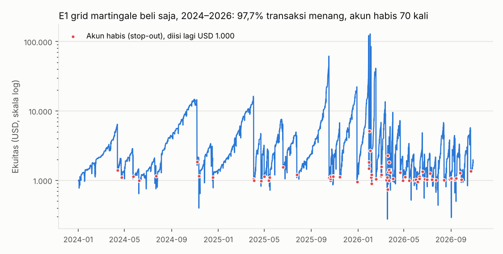
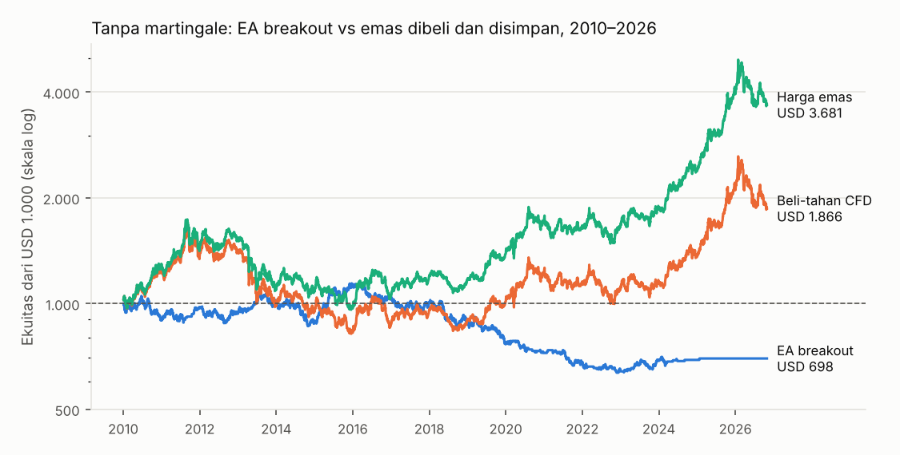

# Laporan Uji EA XAUUSD "Viral"

Anda bilang EA (robot MetaTrader) XAUUSD yang viral itu bagus. Isi EA berbayar tidak bisa dilihat, jadi saya membuat ulang tipe-tipe yang paling sering dijual, dengan pengaturan khas iklannya, lalu menjalankannya di seluruh data emas 2010–2026 — bukan hanya di periode yang dipilih penjualnya. Aturan dikunci dulu di [pra-registrasi](RENCANA_EA_XAUUSD.md) sebelum hasil dihitung.

## Jawaban singkat

- **EA emas yang viral hampir selalu grid/martingale.** Kelihatannya hebat: **98,3% transaksi menang** dan kurva saldo naik mulus — itulah yang di-screenshot. Tetapi di data 2010–2026, versi yang saya buat ulang **habis 167 kali** (umur akun median 15 hari). Dari total setoran USD 168.000, yang tersisa USD 1.792.
- **Di periode viral 2024–2026 pun habis 70 kali**, walaupun harga emas naik +27% per tahun. Versi dua arah ("hedging grid") lebih parah: habis 316 kali.
- **Mengganti pengaturan tidak menyelamatkan.** Cek tambahan dengan 9 kombinasi jarak grid dan pengali lot: semuanya habis 23–255 kali; akun yang paling lama bertahan pun hanya 1.190 hari (±3,3 tahun).
- **EA tanpa martingale (breakout London) tidak pernah habis, tetapi rugi -2,1% per tahun** dengan drawdown 45%.
- **Yang membuat EA emas 2024–2026 terlihat hebat adalah kenaikan harga emas itu sendiri** (+27% per tahun). Emas yang dibeli dan disimpan tanpa robot sudah mendapat itu — tetapi 2011–2015 harganya turun 45% dan baru pulih bertahun-tahun kemudian.
- Hasil: tidak ada tipe EA yang layak menurut syarat yang dikunci sebelumnya.

## 1. Kenapa EA grid/martingale terlihat bagus

Cara kerjanya: beli; kalau harga turun, beli lagi dengan lot lebih besar; tutup semua begitu harga naik sedikit di atas harga rata-rata. Hampir selalu ada pantulan kecil, jadi hampir semua "keranjang" ditutup untung. Masalahnya ada di sisanya: saat emas turun lurus tanpa pantulan, posisi menumpuk dengan lot terbesar dan tanpa stop loss, sampai broker menutup paksa (stop-out).

Di uji ini, untung rata-rata per keranjang E1 USD 198, sedangkan rugi terbesar satu kejadian -USD 929.074 — karena lot otomatis ikut membesar saat saldo tumbuh, satu kejadian menghapus semua untung berbulan-bulan sekaligus. Akun yang tumbuh paling besar baru habis setelah tumbuh ratusan kali lipat (di dunia nyata batas lot broker akan menahan pertumbuhan ini, tetapi tidak mencegah habisnya). Inilah sebabnya screenshot EA viral menampilkan kurva mulus dan "win rate 98%".

## 2. Hasil per tipe EA

Akun USD 1.000, leverage 1:500, biaya spread + swap. Tiap periode dimulai dengan akun baru; akun yang habis diisi lagi USD 1.000.

| Tipe | Periode | Akun habis | Umur akun (median) | Transaksi menang | Bulan hijau | Hasil | Drawdown terburuk |
|---|---|---|---|---|---|---|---|
| E1 Grid martingale beli saja | Seluruh 2010–2026 | 167 | 15 hari | 98% | 53% | USD 168.000 disetor → USD 1.792 | habis |
|  | 2010–2015 | 46 | 29 hari | 99% | 57% | USD 47.000 disetor → USD 1.966 | habis |
|  | 2016–2020 | 25 | 42 hari | 99% | 65% | USD 26.000 disetor → USD 2.277 | habis |
|  | 2021–2026 | 96 | 10 hari | 98% | 41% | USD 97.000 disetor → USD 1.792 | habis |
|  | Periode viral 2024–2026 | 70 | 5 hari | 98% | 38% | USD 71.000 disetor → USD 1.792 | habis |
| E2 Grid martingale dua arah | Seluruh 2010–2026 | 316 | 8 hari | 98% | 37% | USD 317.000 disetor → USD 7.954 | habis |
|  | 2010–2015 | 88 | 14 hari | 99% | 38% | USD 89.000 disetor → USD 4.167 | habis |
|  | 2016–2020 | 57 | 15 hari | 99% | 43% | USD 58.000 disetor → USD 1.796 | habis |
|  | 2021–2026 | 169 | 5 hari | 98% | 33% | USD 170.000 disetor → USD 7.954 | habis |
|  | Periode viral 2024–2026 | 133 | 5 hari | 98% | 21% | USD 134.000 disetor → USD 7.954 | habis |
| E3 Breakout sesi London | Seluruh 2010–2026 | 0 | – | 50% | 42% | USD 698 (-2,1%/th) | 45% |
|  | 2010–2015 | 0 | – | 51% | 58% | USD 1.113 (+1,8%/th) | 19% |
|  | 2016–2020 | 0 | – | 49% | 42% | USD 694 (-7,1%/th) | 35% |
|  | 2021–2026 | 0 | – | 49% | 31% | USD 882 (-2,1%/th) | 22% |
|  | Periode viral 2024–2026 | 0 | – | 49% | 18% | USD 963 (-1,3%/th) | 8% |
| Beli-dan-tahan emas (CFD, bayar swap) | Seluruh 2010–2026 | 0 | – | – | 49% | USD 1.866 (+3,8%/th) | 51% |
|  | 2010–2015 | 0 | – | – | 47% | USD 826 (-3,1%/th) | 51% |
|  | 2016–2020 | 0 | – | – | 48% | USD 1.491 (+8,3%/th) | 20% |
|  | 2021–2026 | 0 | – | – | 51% | USD 1.506 (+7,3%/th) | 29% |
|  | Periode viral 2024–2026 | 0 | – | – | 59% | USD 1.608 (+18,4%/th) | 29% |
| Harga emas saja | Seluruh 2010–2026 | 0 | – | – | 53% | USD 3.681 (+8,1%/th) | 45% |
|  | 2010–2015 | 0 | – | – | 49% | USD 968 (-0,5%/th) | 45% |
|  | 2016–2020 | 0 | – | – | 55% | USD 1.790 (+12,3%/th) | 17% |
|  | 2021–2026 | 0 | – | – | 56% | USD 2.111 (+13,7%/th) | 27% |
|  | Periode viral 2024–2026 | 0 | – | – | 68% | USD 1.951 (+26,7%/th) | 27% |

Syarat "layak" (tidak pernah habis, untung di ≥ 2 dari 3 sub-periode, ≥ 2% per tahun, drawdown ≤ 20%): E1 gagal, E2 gagal, E3 gagal.

E3 melewati 1.842 hari karena lot minimum 0,01 sudah melebihi risiko 1% untuk akun USD 1.000 (di 2024–2026: 605 hari, karena harga emas ±USD 4.000 membuat rentang Asia lebar). EA yang tetap memaksa lot minimum di kondisi itu sebenarnya mempertaruhkan lebih dari 1% per transaksi.

## 3. Cek tambahan: pengaturan grid lain

Bukan bagian pra-registrasi; ditambahkan setelah hasil terlihat untuk menjawab "EA viral pakai pengaturan lain". Grid beli saja, maksimal 10 posisi, take profit 0,3% di atas rata-rata, 2010–2026.

| Jarak grid | Pengali lot | Akun habis | Umur median | Umur terlama | Transaksi menang | Bulan hijau | Setoran → sisa |
|---|---|---|---|---|---|---|---|
| 0,5% | 1,2 | 99 | 31 hari | 562 hari | 98,7% | 61% | USD 100.000 → USD 1.253 |
| 0,5% | 1,5 | 167 | 15 hari | 262 hari | 98,3% | 53% | USD 168.000 → USD 1.792 |
| 0,5% | 2,0 | 255 | 12 hari | 143 hari | 97,8% | 41% | USD 256.000 → USD 1.552 |
| 1,0% | 1,2 | 48 | 64 hari | 622 hari | 99,0% | 62% | USD 49.000 → USD 971 |
| 1,0% | 1,5 | 71 | 37 hari | 604 hari | 98,8% | 67% | USD 72.000 → USD 1.131 |
| 1,0% | 2,0 | 81 | 31 hari | 575 hari | 98,8% | 71% | USD 82.000 → USD 1.076 |
| 2,0% | 1,2 | 23 | 79 hari | 1.190 hari | 99,3% | 62% | USD 24.000 → USD 1.058 |
| 2,0% | 1,5 | 31 | 66 hari | 779 hari | 99,2% | 68% | USD 32.000 → USD 1.237 |
| 2,0% | 2,0 | 35 | 51 hari | 1.014 hari | 99,2% | 72% | USD 36.000 → USD 1.341 |

Grid yang lebih lebar membuat akun bertahan lebih lama dan bulan hijau lebih banyak — persis yang membuatnya lebih meyakinkan untuk dijual — tetapi tetap habis. Kedalaman grid selalu terbatas, sedangkan emas sesekali bergerak lurus 5–15% (April 2013, Agustus 2020, dan beberapa kali di 2024–2026).

## 4. Yang ditampilkan iklan vs kenyataan

Setiap titik merah adalah akun yang habis. Penjual cukup memotong grafik di antara dua titik merah: akun yang paling lama bertahan di periode ini hidup 107 hari dengan kurva naik mulus. Akun-akun yang habis tidak pernah dipamerkan.

## 5. Emas tanpa robot

|  | Seluruh 2010–2026 (per tahun) | 2010–2015 (per tahun) | 2016–2020 (per tahun) | 2021–2026 (per tahun) | Periode viral 2024–2026 (per tahun) | Drawdown terburuk 2010–2026 |
|---|---|---|---|---|---|---|
| E3 Breakout sesi London | -2,1% | +1,8% | -7,1% | -2,1% | -1,3% | 45% |
| Beli-dan-tahan emas (CFD, bayar swap) | +3,8% | -3,1% | +8,3% | +7,3% | +18,4% | 51% |
| Harga emas saja | +8,1% | -0,5% | +12,3% | +13,7% | +26,7% | 45% |

Harga emas naik +8,1% per tahun sejak 2010, tetapi lewat CFD/akun forex swap beli emas memotongnya menjadi +3,8% per tahun. Kalau ingin memiliki emas, emas fisik atau tabungan emas (tanpa swap) lebih masuk akal daripada robot. Rencana di [RENCANA_UNTUNG.md](RENCANA_UNTUNG.md) sudah memasukkan 10% emas.

## 6. Cara memeriksa EA viral sebelum membeli

1. **Minta rekam jejak akun real yang terverifikasi** (Myfxbook atau FXBlue dengan status verified) minimal 2 tahun. Backtest, akun demo, dan screenshot tidak berarti apa-apa.
2. **Lihat riwayat lot.** Lot membesar setelah rugi, atau banyak posisi searah terbuka bersamaan = martingale/grid.
3. **Win rate di atas 90% tanpa stop loss** adalah tanda bahaya, bukan tanda bagus.
4. **Drawdown "4%" biasanya dihitung dari saldo tertutup.** Lihat drawdown ekuitas (termasuk posisi mengambang) — di grid, itulah yang membuat akun habis.
5. **Janji profit tetap per bulan, sistem member/referral, atau dana disetor ke pihak lain** adalah ciri skema Ponzi. Contoh di Indonesia: robot trading emas ATG (Auto Trade Gold) — diblokir Bappebti sejak April 2022, pendirinya ditangkap Maret 2023, polisi menyebut ±25.000 korban.
6. Kirim nama EA, link Myfxbook, atau aturannya ke saya — saya uji dengan cara yang sama di data 2010–2026.

## Kesimpulan

EA XAUUSD yang viral tampak bagus karena dua hal: martingale membuat hampir semua transaksi menang sampai akunnya habis, dan harga emas sedang naik kencang sejak 2024. Di data 16 tahun, tidak ada tipe EA emas yang diuji di sini yang layak dipakai dengan uang sungguhan. Untuk menambah uang, tetap pakai [rencana investasi](RENCANA_UNTUNG.md).

## Sumber

- Data: candle 5 menit XAUUSD OANDA (Hugging Face `bunqi/OANDA_XAUUSD_Gold`), 2010–2026.
- Kasus ATG — [Bisnis.com: perjalanan kasus](https://kabar24.bisnis.com/read/20230308/15/1635461/perjalanan-kasus-crazy-rich-surabaya-wahyu-kenzo-bos-robot-trading-atg), [Bisnis.com: 25 ribu korban](https://kabar24.bisnis.com/read/20230316/16/1637981/cara-crazy-rich-surabaya-wahyu-kenzo-jerat-25-ribu-orang-korbannya-di-8-negara), [Selular.ID: diblokir Bappebti](https://selular.id/2023/03/bappebti-telah-blokir-robot-trading-atg-yang-buat-crazy-rich-surabaya-jadi-tersangka/).
- Contoh iklan EA emas dengan klaim Myfxbook dan peringatan risiko grid dari penjualnya sendiri — [MQL5: Gold Hedge Martingale Pro](https://www.mql5.com/it/market/product/185970), [MQL5: SmartBalance Gold EA](https://www.mql5.com/tr/market/product/187408).
