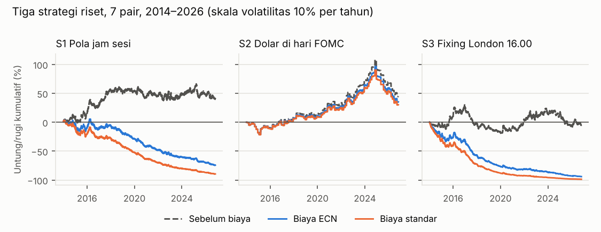
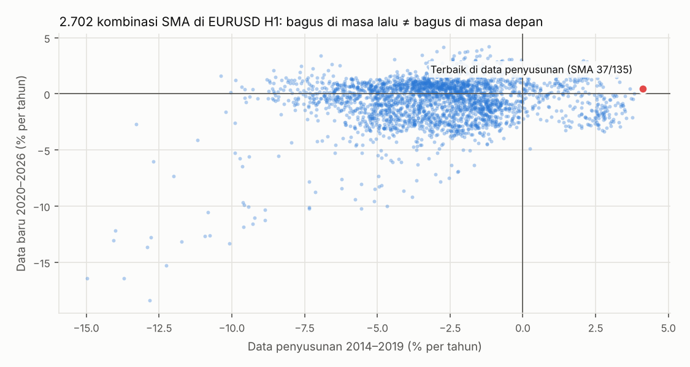

# Laporan Uji Forex Cepat

Permintaan Anda: *"buatkan supaya profit di forex, entah diotak-atik teknikalnya atau main cepat jual beli cepat, bebas, yang penting untung."* Aturan uji dikunci lebih dulu di [pra-registrasi](RENCANA_FOREX_CEPAT.md) (di-commit sebelum hasil dihitung), lalu dijalankan sekali.

## Jawaban singkat

- **Tidak ada cara yang lolos.** Saya sudah mencoba yang Anda minta: jual-beli cepat, tiga pola forex jangka pendek yang diterbitkan di jurnal top, dan mengotak-atik teknikal. Hasilnya rugi atau terlalu kecil untuk dibedakan dari kebetulan.
- **Jual-beli cepat kalah oleh biaya.** Di EURUSD, harga rata-rata hanya bergerak 2,1 pip per 5 menit, sedangkan biaya termurah 0,9 pip per transaksi. Supaya impas, bot harus **benar 72% dari seluruh transaksi** — tidak ada metode yang diketahui bisa begitu. Per detik, gerak harga (±0,12 pip) lebih kecil dari biayanya, jadi mustahil.
- **Mengotak-atik teknikal hanya menghasilkan ilusi.** Dari 2.702 kombinasi SMA, yang terbaik di masa lalu (+4,1% per tahun) hanya +0,5% per tahun di data baru; 10 terbaik rata-rata -0,7%. Peringkat masa lalu hampir tidak berhubungan dengan masa depan (korelasi 0,06).
- **Berita bot "mahasiswa China" bukan bukti bahwa forex bisa diakali dengan bot cepat** — mekanismenya berbeda (bagian D).
- Untuk menambah uang, tetap pakai [rencana investasi](RENCANA_UNTUNG.md). Kalau ingin tetap bermain forex, anggap uang belajar (maksimal 5%), bukan sumber untung.

## A. Jual-beli cepat: berapa persen harus benar supaya impas?

Rata-rata besar gerak harga EURUSD per rentang waktu (2014–2026) dibanding biaya satu transaksi pulang-pergi. Kolom "harus benar" = persentase transaksi yang harus benar arahnya hanya untuk impas, kalau untung saat benar sama dengan rugi saat salah.

| Pegang posisi selama | Rata-rata gerak | Biaya ECN ÷ gerak | Harus benar (ECN 0,9 pip) | Harus benar (standar 1,4 pip) |
|---|---|---|---|---|
| 1 detik (perkiraan) | 0,12 pip | 750% | mustahil (> 100%) | mustahil (> 100%) |
| 5 menit | 2,08 pip | 43% | 71,7% | 83,7% |
| 15 menit | 3,57 pip | 25% | 62,6% | 69,6% |
| 1 jam | 7,15 pip | 13% | 56,3% | 59,8% |
| 4 jam | 14,91 pip | 6% | 53,0% | 54,7% |
| 1 hari | 40,24 pip | 2% | 51,1% | 51,7% |

Semua pair, biaya ECN:

| Pair | Harus benar: 5 menit | 1 jam | 1 hari |
|---|---|---|---|
| EURUSD | 71,7% | 56,3% | 51,1% |
| GBPUSD | 71,7% | 56,3% | 51,1% |
| USDJPY | 69,9% | 55,7% | 51,0% |
| AUDUSD | 76,8% | 57,9% | 51,5% |
| USDCAD | 76,2% | 57,6% | 51,4% |
| USDCHF | 82,6% | 59,7% | 51,8% |
| NZDUSD | 86,0% | 60,6% | 52,0% |

**Artinya:** makin cepat jual-beli, makin besar porsi biaya dibanding gerak harga. Tebakan arah yang sangat bagus (benar 55% dari waktu) sudah luar biasa langka, tetapi itu pun masih rugi di bawah 1 jam. Yang untung dari jual-beli per detik di forex adalah pihak yang **menerima** spread (broker, bank, market maker), bukan yang membayarnya. Baris "1 detik" adalah perkiraan dari data 5 menit (aturan akar waktu), karena data per detik tidak tersedia.

## B. Tiga pola forex dari jurnal, diuji apa adanya

Masing-masing satu aturan tetap dari makalahnya (detail di pra-registrasi), di 7 pair mayor 2014–2026. Empat pair (AUDUSD, USDCAD, USDCHF, NZDUSD) belum pernah dipakai di uji mana pun.

- **S1 Pola jam sesi** (Ranaldo 2009; Breedon & Ranaldo 2013): mata uang cenderung melemah di jam kerja negaranya. Jual mata uang yang pusatnya sedang buka sendirian, beli yang sebaliknya. ±2 transaksi per hari.
- **S2 Dolar di hari FOMC** (Mueller, Tahbaz-Salehi & Vedolin 2017): jual USD dari sore sebelum pengumuman suku bunga Fed sampai sore hari pengumuman. 8 transaksi per tahun.
- **S3 Fixing London** (Krohn, Mueller & Whelan 2024): beli USD sejam sebelum fixing 16.00 London, jual USD sejam sesudahnya. 2 transaksi per hari.

| Strategi | Per tahun sebelum biaya | Setelah biaya ECN | Setelah biaya standar | t-stat (ECN) | Per tahun di skala 10% vol (ECN) | Drawdown terburuk (10% vol) | Per sub-periode 2014–17 / 18–21 / 22–26 (ECN) | Hasil |
|---|---|---|---|---|---|---|---|---|
| S1 Pola jam sesi | +1,29% | -4,05% | -6,85% | -3,63 | -10,1% | 76% | -0,5% / -5,8% / -5,6% | gagal |
| S2 Dolar di hari FOMC | +0,57% | +0,48% | +0,43% | 1,02 | +2,4% | 31% | +0,4% / +0,8% / +0,3% | gagal |
| S3 Fixing London 16.00 | +0,03% | -5,99% | -9,25% | -7,72 | -19,9% | 94% | -5,7% / -5,6% / -6,5% | gagal |

"Per tahun" dihitung untuk posisi 1× nilai di tiap pair (rata-rata 7 pair). "Skala 10% vol" memperbesar posisi sampai naik-turunnya 10% per tahun, supaya bisa dibandingkan. Syarat lolos: t-stat ≥ 2,4, untung di ≥ 2 dari 3 sub-periode, drawdown ≤ 20%, untung di ≥ 2/3 pair.

Per pair, per tahun setelah biaya ECN (posisi 1×):

| Pair | S1 Pola jam sesi | S2 Dolar di hari FOMC | S3 Fixing London 16.00 |
|---|---|---|---|
| EURUSD | +3,40% | +0,50% | -2,86% |
| GBPUSD | -0,79% | +0,90% | -3,77% |
| USDJPY | -8,77% | +0,49% | -5,38% |
| AUDUSD | -8,92% | +0,48% | -8,02% |
| USDCAD | tidak berlaku | +0,38% | -5,39% |
| USDCHF | -4,13% | +0,34% | -6,28% |
| NZDUSD | -9,15% | +0,27% | -10,26% |

**Arti hasil ini:**

- **S1** sebenarnya sedikit untung sebelum biaya (+1,3% per tahun), tetapi ±520 transaksi per tahun per pair membuatnya rugi -4,1% per tahun setelah biaya ECN. Hanya EURUSD yang untung (+3,4%); memilih EURUSD saja setelah melihat hasil ini adalah persis "otak-atik" di bagian C (1 dari 7 pair bisa untung karena kebetulan).
- **S2** satu-satunya yang untung setelah biaya, dan konsisten di 7 pair dan 3 sub-periode. Tetapi hasilnya kecil: +0,48% per tahun untuk posisi 1×, t-stat 1,02 (belum bisa dibedakan dari kebetulan), dan karena hanya 8 hari per tahun, untuk mencapai +2,4% per tahun perlu leverage ±6× dengan drawdown 31%. Ketujuh pair bergerak bersama (semuanya jual USD di hari yang sama), jadi konsistensinya sebenarnya satu taruhan, bukan tujuh.
- **S3** nol sebelum biaya dan rugi besar setelah biaya. Pola yang ditemukan riset sudah tidak cukup besar untuk membayar biaya ritel.

## C. Kalau teknikal diotak-atik sampai bagus

Saya coba 2.702 kombinasi SMA cepat/lambat di EURUSD candle 1 jam. Kombinasi dipilih dari data 2014–2019, lalu dicek di data 2020–2026 yang tidak ikut dipakai memilih. Biaya standar; swap tidak dihitung dan posisi tidak ditutup harian (keduanya menguntungkan demo ini).

|  | Data penyusunan 2014–2019 | Data baru 2020–2026 |
|---|---|---|
| Kombinasi terbaik (SMA 37/135) | +4,1% | +0,5% |
| Rata-rata 10 terbaik | +3,7% | -0,7% |
| Porsi kombinasi yang untung | 11% | 44% |

Kombinasi yang ternyata terbaik di 2020–2026 (SMA 31/110, +4,2% per tahun) justru rugi -1,2% per tahun di 2014–2019 — tidak mungkin dipilih sebelumnya. Inilah sebabnya backtest yang diotak-atik selalu bisa dibuat terlihat bagus, dan selalu mengecewakan saat dipakai: yang ditemukan adalah kebetulan di data lama, bukan pola yang berulang (Bailey, Borwein, López de Prado & Zhu, 2014). Dengan leverage 10×, kombinasi terbaik tadi bisa dipamerkan sebagai backtest +41% per tahun, padahal di data baru hanya +5% per tahun sebelum swap. Justru cara seperti itu yang tidak boleh dipakai.

## D. Soal berita bot "mahasiswa China" yang untung besar

Saya tidak menemukan berita terverifikasi tentang mahasiswa China yang untung besar dengan bot DEX per detik. Yang paling dekat: akun Polymarket "Gravia" milik mahasiswa China di Jepang dengan klaim keuntungan luar biasa, yang diragukan oleh media yang memberitakannya. Apa pun cerita persisnya, bot kripto per detik yang benar-benar untung biasanya bukan menebak arah harga, melainkan:

- **Arbitrase**: membeli di satu bursa/pool dan menjual di tempat lain dalam hitungan detik. Studi terhadap 19 bot arbitrase CEX–DEX terbesar: untung kotor USD 233,8 juta, tetapi hanya USD 90,1 juta yang tersisa setelah membayar pembuat blok, dan peluangnya hilang dalam 0,5–1,5 detik. Ini perlombaan infrastruktur antar tim profesional.
- **MEV / sandwich**: menyalip transaksi orang lain di blockchain. Ini merugikan pengguna lain dan tidak akan saya buatkan.
- **Bias berita**: yang diberitakan adalah satu orang yang menang, bukan ribuan bot yang rugi.

Di forex ritel, semua itu tidak tersedia: tidak ada antrean transaksi publik untuk dilihat, harga datang dari broker, dan bot yang memanfaatkan harga broker yang terlambat (latency arbitrage) dilarang di perjanjian hampir semua broker — transaksinya dibatalkan dan akunnya ditutup.

## Kesimpulan

Dengan semua yang sudah diuji di repo ini — 30-an setup mentor, versi perbaikannya, momentum, tiga pola dari jurnal, scalping, dan otak-atik teknikal — **tidak ada bot forex yang terbukti untung setelah biaya di data yang belum dipakai menyusunnya.** Ini konsisten dengan riset: mayoritas trader ritel forex rugi. Saya tidak bisa membuatkan bot forex yang untung, dan siapa pun yang menjanjikannya sedang menjual sesuatu.

Yang bisa dilakukan:

1. Tambah uang lewat [rencana investasi](RENCANA_UNTUNG.md) (Seimbang 50/40/10, ±6% per tahun, peluang rugi setelah 10 tahun ±2%).
2. Kalau tetap ingin di forex sebagai hobi: maksimal 5% uang, akun demo dulu, pakai `scripts/sinyal.py` (semi-otomatis) dan jurnal. Ukur hasilnya minimal 100 transaksi sebelum menambah.
3. Strategi baru apa pun (dari mentor, grup, atau video) bisa diuji dengan kerangka yang sama: aturan dikunci dulu, lalu diuji sekali di data yang belum dipakai.

## Sumber

- Ranaldo, A. (2009). Segmentation and time-of-day patterns in foreign exchange markets. *Journal of Banking & Finance* 33(12).
- Breedon, F. & Ranaldo, A. (2013). Intraday patterns in FX returns and order flow. *Journal of Money, Credit and Banking* 45(5).
- Mueller, P., Tahbaz-Salehi, A. & Vedolin, A. (2017). Exchange rates and monetary policy uncertainty. *Journal of Finance* 72(3).
- Krohn, I., Mueller, P. & Whelan, P. (2024). Foreign exchange fixings and returns around the clock. *Journal of Finance* 79(1).
- Bailey, D., Borwein, J., López de Prado, M. & Zhu, Q. (2014). Pseudo-mathematics and financial charlatanism. *Notices of the AMS* 61(5).
- Berita akun Polymarket "Gravia" — [money.it](https://www.money.it/da-090-a-408292-in-48-ore-con-l-ai-trading-genio-della-finanza-o-clamorosa-fake-news).
- Ringkasan studi bot arbitrase CEX–DEX — [ChainCatcher](https://www.chaincatcher.com/article/2193465).
- Data: candle 5 menit OANDA (Hugging Face `bunqi/OANDA_*`); jadwal FOMC dari Federal Reserve.
