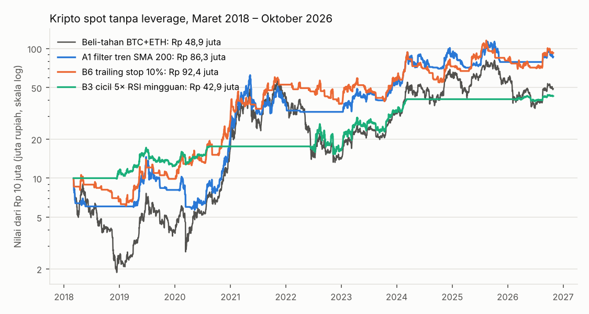
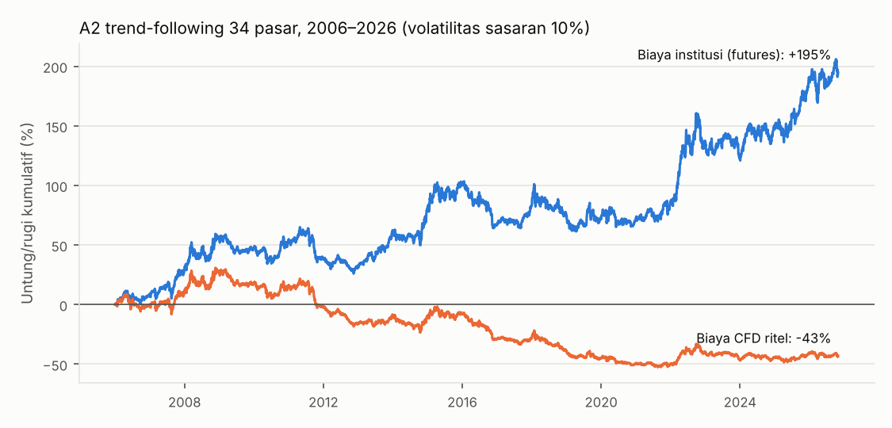

# Laporan: rancangan saya sendiri + semua modul mentor yang belum diuji

Permintaan Anda: *"tanpa mentor, kamu yang buatkan cara supaya untung, hindari masalah yang sudah ketemu, dan sekalian uji semua modul yang belum diuji."* Aturan dikunci dulu di [pra-registrasi](RENCANA_MODUL_BARU.md) sebelum hasil dihitung.

## Jawaban singkat

- **Yang menolong di kripto ternyata bukan menebak pola, tetapi keluar saat tren turun.** Rancangan saya (A1: pegang BTC/ETH hanya selama harga di atas rata-rata 200 hari) memberi +28,5% per tahun dengan turun terdalam -61%, dibanding beli-dan-tahan +20,3% per tahun dengan turun terdalam -81%. Di periode terakhir (Des 2024 – Okt 2026) A1 -0,7%, beli-dan-tahan -18,5%.
- **Trailing stop Ko Andri (B6) dan cicil 5× Kalimasada (B3) juga lolos** dengan cara yang sama: keluar atau tidak masuk saat pasar jatuh. B6 10%: +29,5% per tahun, turun terdalam -42%.
- **Tetap berisiko besar.** "Lolos" di sini artinya lebih baik dari beli-dan-tahan kripto — yang sendiri pernah turun 77–81%. Versi terbaik pun pernah turun 38–61%. Ini hanya untuk porsi kecil uang.
- **Trend-following 34 pasar lewat CFD ritel rugi** (-2,7% per tahun) karena biaya pembiayaan broker. Dengan biaya institusi hasilnya +5,3% per tahun, tetapi turun terdalam -24% melewati batas 20%.
- **Gagal:** Fear & Greed, moon bag (mengurangi hasil), pola harmonic (hampir tidak pernah muncul), dan pola klasik (forex gagal semua; di kripto untung 2017–2024 lalu rugi di uji akhir — pola yang sama dengan setup mentor sebelumnya).
- **Rekomendasi:** uang inti tetap di [rencana Seimbang](RENCANA_UNTUNG.md). Kalau ingin porsi spekulatif, maksimal 10% di kripto spot dengan aturan A1 atau B6, tanpa leverage. Sinyal hariannya sekarang ada di `scripts/sinyal.py`.

## Bagian A — rancangan saya sendiri

Dibuat dari pelajaran uji sebelumnya: transaksi jarang (biaya kecil), aturan sederhana tanpa penyetelan, tanpa martingale dan tanpa leverage di kripto, disebar ke banyak pasar, dan ada aturan keluar saat tren turun.

### A1 · Kripto spot dengan filter tren (SMA 200)

| Versi | Per tahun | Sharpe | Turun terdalam | 2018–20 / 2021–23 / 2024–26 | Des 2024 – Okt 2026 | Hasil |
|---|---|---|---|---|---|---|
| Beli-tahan BTC+ETH 50/50 | +20,3% | 0,62 | -81% | +70% / +86% / +49% | -18,5% | patokan |
| Beli-tahan BTC | +25,4% | 0,68 | -77% | +153% / +44% / +84% | -13,2% | patokan |
| A1 Filter tren SMA 200 (BTC+ETH) | +28,5% | 0,77 | -61% | +104% / +163% / +56% | -0,7% | **lolos** |
| A1 Filter tren SMA 200 (BTC saja) | +26,4% | 0,76 | -64% | +182% / +51% / +69% | -3,1% | **lolos** |

Syarat lolos: Sharpe lebih tinggi **dan** turun terdalam lebih kecil dari beli-dan-tahan, serta untung di ≥ 2 dari 3 sub-periode. Periode dimulai Maret 2018 karena rata-rata 200 hari BTC baru tersedia saat itu. Biaya 0,11% per transaksi; uang di luar pasar tidak berbunga.



A1 hanya berada di pasar ±52% dari waktu dan masuk-keluar ±30 kali per koin dalam 8,6 tahun. Ia tidak menghindari semua penurunan (masih pernah turun 61%), tetapi menghindari sebagian besar pasar bear 2018 dan 2022.

### A2 · Trend-following 34 pasar (indeks, obligasi, komoditas, forex)

| Biaya | Per tahun | Sharpe | t-stat | Turun terdalam | 2006–11 / 2012–18 / 2019–26 | Hasil |
|---|---|---|---|---|---|---|
| Biaya institusi (futures) | +5,3% | 0,53 | 2,41 | -24% | +5,7% / +3,2% / +6,9% | gagal (penurunan ≤ 20%) |
| Biaya CFD ritel | -2,7% | -0,19 | -0,87 | -64% | -0,2% / -6,6% / -0,9% | gagal (t-stat ≥ 2,0, untung ≥ 2 dari 3 sub-periode, hasil ≥ 2% per tahun, penurunan ≤ 20%) |



Versi ritel membayar biaya pembiayaan 2,5% per tahun dari nilai posisi, padahal untuk mencapai volatilitas 10% nilai posisinya rata-rata ±3,5× modal (obligasi butuh posisi besar karena geraknya kecil). Total biaya pembiayaan selama 20 tahun ±122% dari modal awal; bagian obligasi saja menyumbang -62%. Versi institusi (bunga dihitung wajar lewat futures) mirip dengan hasil dana trend-following profesional: positif tetapi naik-turun, dengan tahun-tahun rugi panjang (2009–2012, 2016–2020). Return harga dipakai sebagai perkiraan return berjangka, jadi ada ketidakpastian ±1–2% per tahun.

## Bagian B — modul mentor yang belum diuji

### B1–B6 · Modul investasi spot kripto

| Versi | Per tahun | Sharpe | Turun terdalam | 2018–20 / 2021–23 / 2024–26 | Des 2024 – Okt 2026 | Hasil |
|---|---|---|---|---|---|---|
| B1 Alokasi 70/15/15 (BTC/altcoin/meme) | +45,3% | 0,85 | -80% | +131% / +424% / +91% | -25,5% | **lolos** |
| B1 Pasif BTC+ETH 50/50 (rebalance) | +22,8% | 0,65 | -82% | +67% / +133% / +47% | -16,9% | gagal |
| B1 70% BTC + 30% stablecoin | +25,1% | 0,73 | -61% | +150% / +60% / +66% | -6,0% | **lolos** |
| B3 Cicil 5× masuk/keluar RSI mingguan (BTC+ETH) | +18,4% | 0,77 | -42% | +76% / +87% / +29% | +5,7% | **lolos** |
| B4 Fear & Greed (BTC) | -3,5% | 0,20 | -78% | -38% / -4% / +17% | -9,6% | gagal |
| B5 Halving: 365 hari sebelum s.d. 365 hari sesudah (BTC) | +41,3% | 1,01 | -63% | +271% / +156% / +98% | -6,7% | **lolos** |
| B5 Halving: 365 hari sebelum s.d. 500 hari sesudah (BTC) | +42,9% | 0,99 | -63% | +271% / +121% / +153% | +19,0% | **lolos** |
| B6 Trailing stop 10% (BTC+ETH) | +29,5% | 0,86 | -42% | +179% / +107% / +55% | +27,2% | **lolos** |
| B6 Trailing stop 5% (BTC+ETH) | +33,8% | 1,07 | -38% | +282% / +119% / +45% | +11,7% | **lolos** |

Catatan per modul:

- **B1 70/15/15** terlihat paling tinggi (+45,3% per tahun), tetapi kelebihannya hampir seluruhnya dari lonjakan DOGE di 2021 (porsi meme 15% saat itu hanya berisi DOGE). Cek tambahan (bukan pra-registrasi): kalau porsi meme diganti stablecoin, hasilnya +26,4% per tahun dengan turun terdalam -71%. Selain itu data meme bias: meme coin yang mati sebelum listing di Binance tidak ada di data. Turun terdalamnya juga paling dalam (±80%).
- **B1 70% BTC + 30% stablecoin** lolos tipis: hasil hampir sama dengan beli-dan-tahan dengan turun terdalam lebih kecil.
- **B3 cicil 5×** hanya membeli di dasar pasar bear (RSI mingguan di bawah 30) dan menjual bertahap saat RSI di atas 70, jadi sering memegang kas. Hasilnya lebih kecil, tetapi turun terdalamnya paling ringan di antara versi yang lolos.
- **B4 Fear & Greed gagal**: "extreme greed" sering muncul di awal kenaikan besar, jadi aturan ini menjual terlalu cepat dan membeli lagi setelah harga jauh lebih mahal.
- **B5 halving** lolos, tetapi hanya ada 2 siklus di data dan aturannya memang disusun dari sejarah siklus itu sendiri. Dua kejadian tidak bisa membuktikan apa-apa; jangan dijadikan dasar.
- **B6 trailing stop** (Ko Andri) lolos di kedua versi. Aturan masuk lagi (tertinggi 20 hari) adalah pilihan saya karena tidak disebut mentor, jadi B6 sebenarnya juga aturan tren seperti A1.

### B2 · Moon bag (cicilan bulanan USD 100 ke komposisi 70/15/15)

| Versi | Total setor | Nilai akhir | Kelipatan | Turun terdalam (nilai ÷ setoran) | Hasil |
|---|---|---|---|---|---|
| Dengan moon bag | USD 10.400 | USD 35.616 | 3,42× | -84% | gagal |
| Tanpa moon bag | USD 10.400 | USD 53.386 | 5,13× | -88% | patokan |

Menjual separuh saat harga 2× membuat modal "aman", tetapi di kripto 2018–2026 itu memotong kenaikan berikutnya yang jauh lebih besar, dan kas hasil penjualan tidak berbunga.

### B7 · Pola grafik (pemilihan G-17 yang sama dengan 30 setup sebelumnya)

| Setup | Pasar | Penyusunan | Pemilihan | Uji akhir | Status |
|---|---|---|---|---|---|
| AFS-11G Harmonic Gartley | Forex (EURUSD, XAUUSD) | 5 trx · -2,1% | 4 trx · -1,1% | – | belum bisa dinilai |
|  | Kripto (BTC, ETH) | 4 trx · +2,0% | 3 trx · -0,0% | – | belum bisa dinilai |
| AFS-11B Harmonic Bat | Forex (EURUSD, XAUUSD) | 4 trx · +1,8% | 2 trx · +1,0% | – | belum bisa dinilai |
|  | Kripto (BTC, ETH) | 2 trx · -2,0% | 1 trx · -1,0% | – | belum bisa dinilai |
| AFS-11C Harmonic Crab | Forex (EURUSD, XAUUSD) | 1 trx · -1,0% | 0 trx · +0,0% | – | belum bisa dinilai |
|  | Kripto (BTC, ETH) | 2 trx · -2,0% | 0 trx · +0,0% | – | belum bisa dinilai |
| AFS-11F Harmonic Butterfly | Forex (EURUSD, XAUUSD) | 0 trx · +0,0% | 1 trx · -1,1% | – | belum bisa dinilai |
|  | Kripto (BTC, ETH) | 1 trx · -1,0% | 1 trx · +2,0% | – | belum bisa dinilai |
| AFS-23H Head & shoulders (dan kebalikannya), tembus neckline | Forex (EURUSD, XAUUSD) | 53 trx · -5,9% | 22 trx · +1,3% | – | belum bisa dinilai |
|  | Kripto (BTC, ETH) | 166 trx · +27,6% | 86 trx · +1,3% | 43 trx · -10,9% | tidak lolos |
| AFS-23T Ascending/descending triangle, masuk sebelum breakout | Forex (EURUSD, XAUUSD) | 84 trx · -16,2% | 27 trx · -1,0% | – | belum bisa dinilai |
|  | Kripto (BTC, ETH) | 49 trx · +17,7% | 17 trx · +3,9% | – | belum bisa dinilai |
| AFS-23W Rising/falling wedge, 3 sentuhan | Forex (EURUSD, XAUUSD) | 62 trx · -1,8% | 21 trx · -1,4% | – | belum bisa dinilai |
|  | Kripto (BTC, ETH) | 50 trx · +13,0% | 17 trx · +7,0% | – | belum bisa dinilai |
| AFS-23B Broadening (megaphone), 3 sentuhan, masuk di sisi luar | Forex (EURUSD, XAUUSD) | 27 trx · -0,1% | 7 trx · +4,5% | – | belum bisa dinilai |
|  | Kripto (BTC, ETH) | 117 trx · +21,9% | 51 trx · +6,3% | 54 trx · -6,4% | tidak lolos |

- **Harmonic hampir tidak pernah muncul** dengan rasio persis dari mentor dan titik swing yang objektif: 0–5 transaksi per pasar dalam 9–16 tahun, jadi tidak bisa dinilai. Di grafik, pola ini sering "terlihat" karena mata kita memilih titik yang cocok.
- **Pola klasik** banyak muncul, tetapi di forex semuanya rugi di data penyusunan atau pemilihan. Di kripto, head & shoulders dan broadening untung di 2017–2024 lalu rugi di uji akhir — persis pola setup mentor sebelumnya.

### Modul yang tidak bisa diuji

| Modul | Alasan |
|---|---|
| Elliott Wave, Andrews Pitchfork | Penghitungan gelombang / pemilihan titik pivot subjektif |
| Akselerasi/deselerasi | Mentor tidak memberi angka |
| Wyckoff spring/UTAD | Butuh penilaian tahap A–E; versi yang bisa dikodekan (AFS-06) sudah diuji dan gagal |
| Order flow | Mentor tidak menyebut entry, SL, dan TP |
| Token baru (TGE) | Butuh data valuasi investor tiap token |
| Screening altcoin | Filter untuk setup trading altcoin; butuh data dominasi BTC historis |
| Valuasi Ko Andri, bandarmologi Ko Hengki, ARA/ARB | Data saham BEI yang tersedia hanya 61 saham besar sejak 2023, tanpa riwayat fundamental dan broker summary. Kalau Anda punya ekspor data (misalnya dari Stockbit), modul ini bisa diuji |

## Kesimpulan

Ilmu baru dari uji ini:

1. **Di kripto, keunggulan yang bisa dibuktikan adalah menghindari pasar bear, bukan menebak titik masuk.** Tiga aturan yang lolos (A1, B3, B6) semuanya bekerja dengan cara keluar atau tidak masuk saat tren turun.
2. **Biaya menentukan segalanya.** Strategi yang terbukti di riset (trend-following multi-aset) berubah dari untung menjadi rugi hanya karena biaya pembiayaan CFD.
3. **Pola grafik yang "terlihat" di chart sering tidak muncul kalau aturannya dibuat objektif**, atau muncul tetapi tidak bertahan di data baru.

Batasan yang tetap berlaku: 12 versi kripto diuji, jadi sebagian yang lolos bisa karena kebetulan; periode 2018–2026 termasuk kenaikan besar kripto yang belum tentu terulang; biaya exchange berizin OJK dan pajak transaksi kripto di Indonesia belum dihitung.

**Cara memakai (semi-otomatis):**

```bash
python -m bot.data.download kripto_harian
```

```bash
python scripts/sinyal.py
```

Bagian "Kripto spot tanpa leverage" di laporan sinyal memberi status hari ini untuk BTC dan ETH: PEGANG atau STABLECOIN, menurut A1 dan B6. Eksekusi di open berikutnya, tanpa leverage, dan hanya dengan uang yang siap turun separuhnya.
