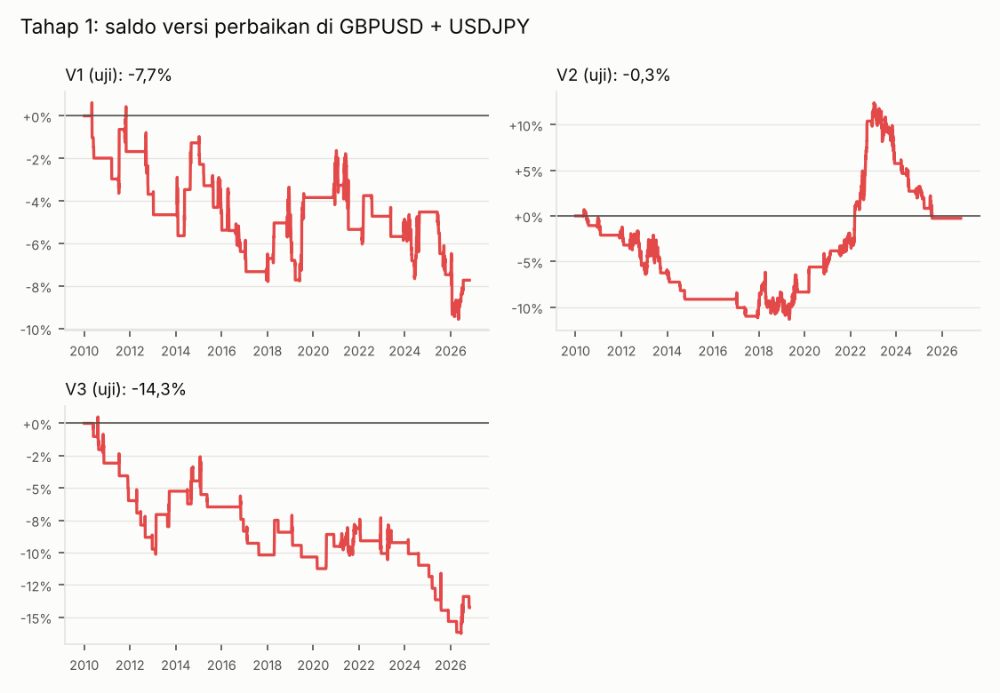
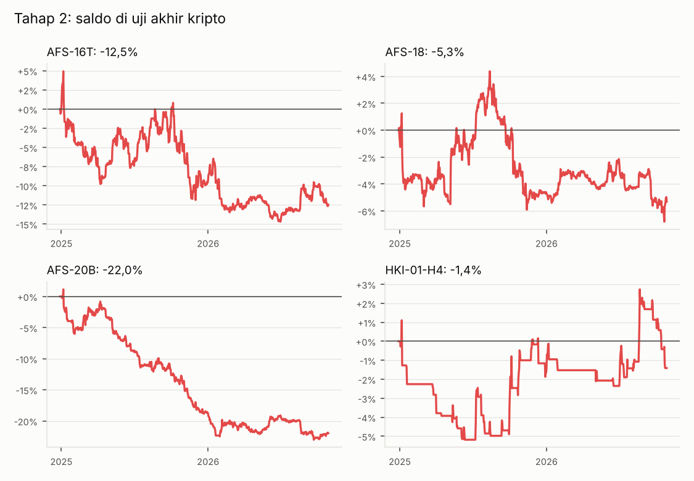
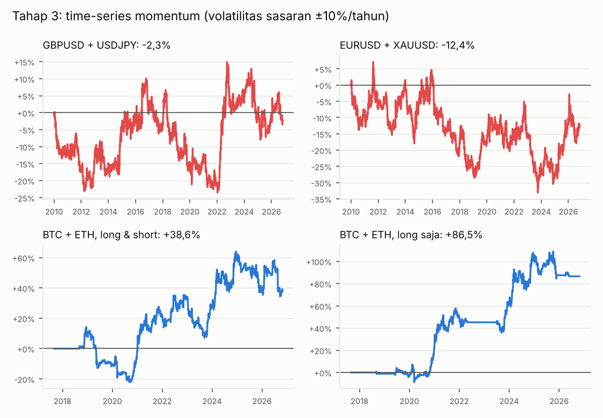

# Laporan rencana cadangan: perbaikan terbatas, kripto, dan patokan riset

Dibuat otomatis oleh `scripts/make_report_cadangan.py`. Rencana, data, dan aturan penilaiannya sudah ditulis dan di-commit **sebelum** pengujian, di [`RENCANA_CADANGAN.md`](RENCANA_CADANGAN.md). Tidak ada aturan yang diubah setelah hasil terlihat.

## Jawaban singkat

1. **Perbaikan terbatas (tahap 1), dinilai di GBPUSD + USDJPY yang belum pernah disentuh:** V1 -7,7% (45 transaksi); V2 -0,3% (40 transaksi); V3 -14,3% (46 transaksi); V4 +0,0% (0 transaksi). **0 dari 4 versi lolos.** V4 sama sekali tidak menghasilkan transaksi: di H1, aturan TP mentor (likuiditas terdekat dengan RR ≥ 1:2) tidak pernah terpenuhi.
2. **Setup mentor saham–kripto di BTC & ETH (tahap 2):** 4 dari 26 setup lolos syarat di data penyusunan & pemilihan (2017–2024), sebagian dengan untung besar. Tetapi di uji akhir (2024-12-29 – 2026-10-28) **semuanya rugi**: AFS-16T -12,8%; AFS-18 -4,8%; AFS-20B -22,0%; HKI-01-H4 -1,4%. **0 lolos.** Versi long saja (akun spot) juga rugi.
3. **Patokan riset, time-series momentum (tahap 3):** di GBPUSD + USDJPY hasilnya -0,1% per tahun (drawdown terburuk 31%); di BTC + ETH versi long saja +7,0% per tahun (drawdown 15%), tetapi rugi -7,1% di periode uji akhir kripto.
4. **Bot full otomatis realistis?** **Belum.** Dengan aturan yang ditetapkan sebelum pengujian, tidak ada pilihan yang layak: semua versi setup mentor rugi di data yang belum pernah disentuh, dan patokan riset pun hanya untung di kripto dengan hasil yang naik-turun.
5. **Hasil wajar per tahun:** untuk setup mentor yang diotomatisasi, perkiraan terbaik dari data ini adalah **sekitar impas sampai rugi** setelah biaya. Untuk pendekatan sistematis terbaik yang diuji (momentum, risiko sasaran ±10% volatilitas per tahun), sekitar **0% per tahun di forex** dan **±5–7% per tahun di kripto long saja**, dengan drawdown 15–30% dan tahun-tahun rugi. Target 20% per tahun (patokan Ko Andri, AND-03) tidak realistis tanpa risiko yang jauh lebih besar.
6. **Usulan:** versi **semi-otomatis** — bot memindai sinyal, menghitung lot dan mengingatkan aturan risiko; Anda yang memutuskan dan mengeksekusi di akun demo dulu, dan setiap sinyal dicatat di jurnal untuk dinilai. Rinciannya di bagian akhir.

## Jumlah varian yang dicoba

| Tahap | Yang diuji | Varian | Data penilaian |
|---|---|---|---|
| (sebelumnya) backtest forex tahap 2 | 30 setup di EURUSD + XAUUSD | 164 | uji akhir EURUSD/XAUUSD Jun 2023 – Okt 2026 (sudah terpakai) |
| 1 — perbaikan terbatas | V1–V4, satu konfigurasi terkunci per versi | **4** (tidak ada jalan ulang) | GBPUSD + USDJPY 2010–2026 |
| 2 — kripto | 26 setup mentor saham–kripto, pemilihan G-17 | **128** | BTC + ETH 2024-12-29 – 2026-10-28 |
| 3 — patokan riset | time-series momentum, parameter dari makalah | **1** (dijalankan di 4 kumpulan data, tanpa penyetelan) | sama dengan tahap 1 dan 2 |

Makin banyak varian yang dicoba, makin besar kemungkinan ada yang terlihat bagus hanya karena kebetulan (Bailey dkk. 2014). Karena itu tahap 1 dan 3 sengaja memakai sesedikit mungkin varian.

## Tahap 1 — perbaikan terbatas setup mentor (forex)

Dirancang dengan EURUSD + XAUUSD (data yang sudah terlihat), lalu **dinilai sekali** di GBPUSD + USDJPY. Periode: 2010–2020 / 2020–2023 / 2023–2026, sama dengan tahap 2.

| Versi | Data rancangan EURUSD+XAUUSD: Trx · Untung/rugi · DD · RF | **Data uji GBPUSD+USDJPY**: Trx · Untung/rugi · DD · RF | Uji per periode (2010–20 / 20–23 / 23–26) | Per instrumen uji | Lolos? | Layak otomatis? |
|---|---|---|---|---|---|---|
| **V1** ICH-01 di timeframe D1 (bias W1) | 41 · -5,4% · 13,5% · -0,37 | 45 · -7,7% · 10,5% · -0,73 | -3,8% / -1,9% / -2,2% | GBPUSD 19 trx -1,6%; USDJPY 26 trx -6,1% | tidak | tidak |
| **V2** Konsensus tren D1 (struktur + Kumo + MA21) + pullback EMA 13/21 | 29 · -16,3% · 16,4% · -0,99 | 40 · -0,3% · 12,0% · -0,02 | -8,3% / +19,7% / -6,8% | GBPUSD 22 trx +3,5%; USDJPY 18 trx -3,8% | tidak | tidak |
| **V3** AFS-05 EMA 13/21 di H4, hanya searah struktur D1 | 39 · -1,1% · 12,0% · -0,09 | 46 · -14,3% · 17,0% · -0,84 | -10,3% / +1,2% / -5,5% | GBPUSD 22 trx -6,7%; USDJPY 24 trx -7,5% | tidak | tidak |
| **V4** AFS-06 stop hunt + BMS di H1, hanya searah struktur D1 | 0 · – · – · – | 0 · – · – · – | +0,0% / +0,0% / +0,0% | GBPUSD 0 trx +0,0%; USDJPY 0 trx +0,0% | tidak | tidak |

Aturan "layak otomatis" (ditetapkan sebelumnya): lolos, untung juga di data rancangan, untung di ≥ 2 dari 3 periode uji, hasil ≥ 2% per tahun, dan drawdown ≤ 20%.

**Kenapa gagal, dengan bahasa sederhana:** memindah setup ke timeframe besar memang memperkecil biaya per transaksi, tetapi jumlah transaksinya juga turun drastis (±40 dalam 16 tahun untuk dua pair), dan sinyalnya sendiri tidak punya keunggulan yang cukup. Filter kondisi pasar (searah struktur D1) tidak mengubah hasil itu.

## Tahap 2 — setup mentor saham–kripto di pasar asalnya (BTC & ETH)

Data spot Binance 5 menit, dibagi menurut tanggal: penyusunan 2017-09-01 – 2023-03-01, pemilihan 2023-03-01 – 2024-12-29, uji akhir 2024-12-29 – 2026-10-28. Biaya pulang-pergi 0,22% (komisi + spread), leverage 1×, berita FOMC/CPI/NFP.

| Setup | Status | Varian | Pilihan terkunci | Penyusunan: Trx · Untung/rugi · DD · RF | Pemilihan: Trx · Untung/rugi · DD · RF | **Uji akhir**: Trx · Untung/rugi · DD · RF | Uji akhir long saja |
|---|---|---|---|---|---|---|---|
| **AFS-01** Technical Research 5 tahap, versi swing (D1 / H4 / M15) | belum bisa dinilai (semua varian rugi di data penyusunan atau pemilihan) | 5 | (gambaran) 5 dari 5 poin; pola wajib; jarak SL 1×ATR | 55 · +2,8% · 7,9% · 0,32 | 19 · -2,6% · 9,4% · -0,27 | – · – · – · – | – |
| **AFS-02** Technical Research 5 tahap, versi scalping (H1 / M15 / M5) | belum bisa dinilai (semua varian rugi di data penyusunan atau pemilihan) | 6 | (gambaran) 5 dari 5 poin; pola wajib; jarak SL 1×ATR; scalping maks 3 jam | 181 · -24,1% · 24,3% · -0,99 | 50 · -6,3% · 10,0% · -0,62 | – · – · – · – | – |
| **AFS-03** Double/triple top-bottom + tembus neckline (M15, scalping) | belum bisa dinilai (semua varian rugi di data penyusunan atau pemilihan) | 7 | (gambaran) selisih puncak ≤ 0,5×ATR; versi konfirmasi; jarak SL 1×ATR; scalping maks 24 jam | 4028 · -90,2% · 90,6% · -0,96 | 1328 · -72,1% · 72,7% · -0,99 | – · – · – · – | – |
| **AFS-04** Pantulan Fibonacci golden pocket 0,5–0,618 (D1 & W1) | belum bisa dinilai (transaksi terlalu sedikit: < 30 di data pemilihan di semua varian) | 7 | (gambaran) versi antisipasi; faktor k ×1; pantulan 4% (kripto); jarak SL 1×ATR; 1 TP 1 SL | 10 · +4,9% · 3,0% · 1,58 | 2 · +4,4% · 1,3% · 3,38 | – · – · – · – | – |
| **AFS-05** Money magnet EMA 13 & 21 | belum bisa dinilai (varian yang untung di kedua bagian transaksinya < 30; varian yang transaksinya cukup rugi di salah satu bagian) | 5 | (gambaran) timeframe D1; jarak SL 1,5×ATR | 20 · +22,4% · 8,4% · 2,01 | 8 · +4,9% · 2,9% · 1,67 | – · – · – · – | – |
| **AFS-06** Stop hunt + break of structure | belum bisa dinilai (semua varian rugi di data penyusunan atau pemilihan) | 10 | (gambaran) tembus ≥ 0,1×ATR; kembali ≤ 2 candle; masuk saat candle BMS close; limit batal setelah 20 candle; jarak SL 1×ATR | 61 · -10,7% · 15,4% · -0,67 | 23 · -3,2% · 9,3% · -0,33 | – · – · – · – | – |
| **AFS-07** Change of character (CHoCH) + retest | belum bisa dinilai (transaksi terlalu sedikit: < 30 di data pemilihan di semua varian) | 5 | (gambaran) retest maks 10 candle; jarak SL 0,5×ATR | 15 · -8,7% · 10,7% · -0,80 | 9 · -0,1% · 4,4% · -0,01 | – · – · – · – | – |
| **AFS-08** Revisit fair value gap setelah BOS | belum bisa dinilai (transaksi terlalu sedikit: < 30 di data pemilihan di semua varian) | 5 | (gambaran) limit batal setelah 20 candle; jarak SL 1,5×ATR | 34 · -13,6% · 21,4% · -0,63 | 3 · -3,0% · 3,5% · -0,85 | – · – · – · – | – |
| **AFS-09** Validasi tembus 3% Dow Theory (MA21, D1) | belum bisa dinilai (transaksi terlalu sedikit: < 30 di data pemilihan di semua varian) | 3 | (gambaran) faktor k ×1; jarak SL 1,5×ATR | 13 · -6,3% · 7,5% · -0,83 | 3 · +0,9% · 4,6% · 0,19 | – · – · – · – | – |
| **AFS-10** Pola ABCD (M15 & H1) | belum bisa dinilai (semua varian rugi di data penyusunan atau pemilihan) | 3 | (gambaran) jarak SL 1,5×ATR | 790 · -54,9% · 61,3% · -0,80 | 263 · -43,4% · 44,9% · -0,94 | – · – · – · – | – |
| **AFS-12** Pivot point: entry di garis P | belum bisa dinilai (semua varian rugi di data penyusunan atau pemilihan) | 6 | (gambaran) timeframe H1; SL di bawah S1; jarak SL 0,5×ATR | 151 · -13,4% · 29,6% · -0,38 | 74 · -3,0% · 20,2% · -0,14 | – · – · – · – | – |
| **AFS-13A** Keltner Channel mode tren (retest garis tengah) | belum bisa dinilai (semua varian rugi di data penyusunan atau pemilihan) | 7 | (gambaran) timeframe D1; jarak SL 1×ATR; retest maks 15 candle | 34 · -2,0% · 6,6% · -0,29 | 18 · +0,0% · 5,6% · 0,00 | – · – · – · – | – |
| **AFS-13B** Keltner Channel mode pantulan (pita luar) | belum bisa dinilai (semua varian rugi di data penyusunan atau pemilihan) | 5 | (gambaran) timeframe D1; jarak SL 1,5×ATR | 91 · -3,5% · 21,8% · -0,16 | 30 · -5,4% · 10,9% · -0,48 | – · – · – · – | – |
| **AFS-14** Ichimoku di atas/bawah semua garis (D1) | belum bisa dinilai (transaksi terlalu sedikit: < 30 di data pemilihan di semua varian) | 3 | (gambaran) jarak SL 1×ATR | 22 · +11,1% · 7,5% · 1,38 | 8 · +12,2% · 3,3% · 3,58 | – · – · – · – | – |
| **AFS-15** Parabolic SAR titik ke-2 | belum bisa dinilai (semua varian rugi di data penyusunan atau pemilihan) | 4 | (gambaran) timeframe H1; jarak SL 0,5×ATR | 1235 · -74,9% · 80,5% · -0,83 | 352 · +27,1% · 19,1% · 1,25 | – · – · – · – | – |
| **AFS-16P** Donchian Channel mode pantulan | belum bisa dinilai (semua varian rugi di data penyusunan atau pemilihan) | 5 | (gambaran) timeframe D1; jarak SL 1,5×ATR | 173 · -43,8% · 46,6% · -0,91 | 57 · +1,4% · 15,3% · 0,08 | – · – · – · – | – |
| **AFS-16T** Donchian Channel mode tren (silang garis tengah) | tidak lolos | 7 | timeframe H4; jarak SL 1×ATR; retest maks 10 candle | 125 · +72,3% · 14,4% · 3,28 | 55 · +33,4% · 10,0% · 2,58 | 51 · -12,8% · 19,2% · -0,63 | 51 · -12,8% · 19,2% · -0,63 |
| **AFS-17** KST silang di garis nol (D1) | belum bisa dinilai (transaksi terlalu sedikit: < 30 di data pemilihan di semua varian) | 3 | (gambaran) jarak SL 1,5×ATR | 12 · -2,7% · 8,6% · -0,31 | 6 · +3,0% · 5,0% · 0,56 | – · – · – · – | – |
| **AFS-18** Konfirmasi Chaikin Money Flow (breakout & divergensi) | tidak lolos | 4 | timeframe H4; jarak SL 1×ATR | 110 · +40,1% · 11,1% · 2,84 | 46 · +17,6% · 8,0% · 1,93 | 28 · -4,8% · 11,3% · -0,41 | 55 · -9,6% · 19,4% · -0,48 |
| **AFS-19** Pantulan POC volume profile | belum bisa dinilai (semua varian rugi di data penyusunan atau pemilihan) | 4 | (gambaran) POC bulan lalu (H4); jarak SL 1×ATR | 321 · -23,0% · 32,2% · -0,66 | 132 · +14,2% · 16,2% · 0,81 | – · – · – · – | – |
| **AFS-20R** Linear Regression Channel mode range (H4) | belum bisa dinilai (semua varian rugi di data penyusunan atau pemilihan) | 3 | (gambaran) jarak SL 0,5×ATR | 408 · -41,2% · 46,0% · -0,85 | 152 · -17,1% · 30,9% · -0,54 | – · – · – · – | – |
| **AFS-20B** Linear Regression Channel mode breakout + retest (H4) | tidak lolos | 5 | jarak SL 1×ATR; retest maks 10 candle | 98 · +43,7% · 9,4% · 4,42 | 42 · +6,8% · 10,1% · 0,61 | 27 · -22,0% · 24,2% · -0,90 | 33 · -16,1% · 17,2% · -0,92 |
| **AFS-21** Renko reversal (D1) | belum bisa dinilai (transaksi terlalu sedikit: < 30 di data pemilihan di semua varian) | 3 | (gambaran) jarak SL 1×ATR | 13 · -2,9% · 5,6% · -0,51 | 4 · -1,0% · 2,4% · -0,43 | – · – · – · – | – |
| **KMS-02** Wyckoff breakout range + retest (D1) | belum bisa dinilai (transaksi terlalu sedikit: < 30 di data pemilihan di semua varian) | 5 | (gambaran) jarak SL 1,5×ATR; retest maks 10 candle | 20 · +3,4% · 9,1% · 0,35 | 15 · +0,3% · 7,1% · 0,05 | – · – · – · – | – |
| **HKI-01-D1** Ikuti tren sekunder (D1), keluar saat struktur patah | belum bisa dinilai (transaksi terlalu sedikit: < 30 di data pemilihan di semua varian) | 4 | (gambaran) buy on breakout; jarak SL 1,5×ATR | 19 · +15,6% · 3,9% · 3,37 | 8 · +6,2% · 2,7% · 2,22 | – · – · – · – | – |
| **HKI-01-H4** Ikuti tren minor (H4), keluar saat struktur patah | tidak lolos | 4 | buy on breakout; jarak SL 1×ATR | 107 · +46,1% · 6,3% · 5,12 | 45 · +15,1% · 4,7% · 2,81 | 40 · -1,4% · 6,7% · -0,21 | 40 · -1,4% · 6,7% · -0,21 |

**Pola yang terlihat:** setup tren/breakout (Donchian mode tren, CMF breakout, LRC breakout, Ko Hengki breakout H4) sangat untung di 2017–2024 — periode dengan tren kripto yang kuat — lalu rugi di 2025–2026. Setup pembalikan dan scalping rugi besar sejak awal karena biaya 0,22% per transaksi terlalu berat untuk timeframe kecil (entry acak di M15 rata-rata -0,41 R per transaksi, di D1 -0,05 R). Hasil bagus di data penyusunan dan pemilihan ternyata tidak bertahan di data baru.

## Tahap 3 — patokan dari riset: time-series momentum

Aturan dari Moskowitz, Ooi & Pedersen (2012) dan Hurst, Ooi & Pedersen (2017): tiap akhir bulan, pegang long kalau harga lebih tinggi dari 12 bulan lalu dan short kalau lebih rendah; ukuran posisi diatur supaya volatilitas portofolio ±10% per tahun. Di riset aslinya, aturan ini diuji di puluhan pasar berjangka sekaligus (58 di makalah 2012, 67 sejak 1880 di makalah 2017) dan hasilnya positif dalam jangka panjang. Di sini hanya ada 2 instrumen per pasar, jadi manfaat diversifikasinya jauh lebih kecil.

| Data | Seluruh periode: hasil/tahun · drawdown · Sharpe | Periode 1 | Periode 2 | Periode 3 (uji akhir) | Biaya spread + swap |
|---|---|---|---|---|---|
| GBPUSD + USDJPY (data uji tahap 1) | -0,1%/th · 30,5% · 0,04 | -18,3% | +20,4% | -5,1% | -0,7% + -17,1% |
| EURUSD + XAUUSD (instrumen bot) | -0,8%/th · 37,5% · -0,02 | -13,7% | -14,2% | +18,0% | -0,7% + -34,3% |
| BTC + ETH, long & short | +3,6%/th · 31,8% · 0,35 | +21,9% | +30,2% | -12,5% | -1,1% + 0,0% |
| BTC + ETH, long saja (spot) | +7,0%/th · 14,8% · 0,71 | +45,2% | +38,3% | -7,1% | -0,7% + 0,0% |

Periode forex: 2010–2020 / 2020–2023 / 2023–2026. Periode kripto: sama dengan tahap 2. Kripto baru punya sinyal setelah data 12 bulan pertama (mulai Agustus 2018). Sharpe = hasil rata-rata ÷ naik-turunnya; di bawah 0,5 tergolong lemah.

**Arti hasil ini:** bahkan pendekatan yang terbukti di riset hampir tidak menghasilkan apa-apa di 2 pair forex selama 2010–2026 (swap CFD menggerus ±1–2% per tahun karena posisi dipegang terus), dan di kripto hasilnya bergantung pada beberapa tahun tren kuat (2020, 2021, 2024). Jadi kegagalan setup mentor bukan karena kode bot, tetapi karena keunggulan yang bisa diotomatisasi di pasar ini memang kecil.

## Perbandingan di data yang belum pernah disentuh

| Pendekatan | Data penilaian | Hasil |
|---|---|---|
| Setup mentor diperbaiki (terbaik: V2) | GBPUSD + USDJPY 2010–2026 | -0,3% total, drawdown 12,0% |
| Time-series momentum | GBPUSD + USDJPY 2010–2026 | -2,3% total (-0,1%/th), drawdown 30,5% |
| Setup mentor di kripto (terbaik: HKI-01-H4) | BTC + ETH uji akhir | -1,4%, drawdown 6,7% |
| Time-series momentum, long saja | BTC + ETH uji akhir | -7,1%, drawdown 11,7% |

## Kesimpulan jujur

**Bot full otomatis belum realistis.** Tiga jalur cadangan sudah dicoba berurutan dengan aturan yang ditetapkan di depan:
1. Perbaikan terbatas setup mentor: tidak ada yang untung di pair yang belum pernah disentuh.
2. Setup mentor saham–kripto di pasar asalnya: untung besar di 2017–2024, tetapi semuanya rugi di 22 bulan terakhir yang belum pernah dilihat. Pola ini — bagus di data lama, gagal di data baru — adalah tanda klasik hasil yang tidak bisa diandalkan.
3. Patokan riset: sekitar impas di forex; di kripto long saja positif dalam jangka panjang tetapi juga rugi di periode terakhir.

Catatan adil: periode uji akhir kripto hanya ±22 bulan dan sebagian besar berupa pasar turun/menyamping. Strategi tren memang biasa mengalami periode rugi panjang, jadi kegagalan ini belum membuktikan bahwa setup tren kripto *tidak punya* keunggulan sama sekali. Tetapi data ini juga tidak bisa membuktikan sebaliknya, dan menurut aturan yang ditetapkan di depan, hasilnya tidak lolos. Satu-satunya cara jujur untuk tahu adalah mengamati ke depan (demo), bukan menguji ulang data yang sama.

**Hasil per tahun yang wajar diharapkan** dari bot yang benar-benar otomatis di pasar ini, berdasarkan data uji: **sekitar 0% (forex) sampai ±5–7% per tahun (kripto, momentum long saja)**, dengan drawdown 15–30% dan beberapa tahun rugi. Angka ini pada risiko sasaran ±10% volatilitas per tahun; menggandakan ukuran posisi kira-kira menggandakan hasil **dan** drawdown-nya. Riset momentum yang lebih luas (puluhan pasar) melaporkan hasil positif jangka panjang, tetapi itu butuh diversifikasi yang tidak tersedia dengan 2–4 instrumen. Angka 20% per tahun ke atas secara konsisten tidak didukung data ini.

**Yang paling mendekati** untuk diamati lebih lanjut (bukan untuk uang sungguhan): momentum bulanan long saja di BTC/ETH, dan keluarga setup tren/breakout di kripto H4 (AFS-16T, AFS-18, AFS-20B, HKI-01-H4). Keduanya hanya untung saat pasar sedang tren kuat.

## Usulan versi semi-otomatis (bot memberi sinyal, Anda yang mengeksekusi)

Sudah dibuat di `scripts/sinyal.py`, tanpa koneksi broker:

1. Perbarui data: `python -m bot.data.download forex crypto`.
2. Jalankan `python scripts/sinyal.py`. Hasilnya `reports/sinyal/<tanggal>.md`: order baru dari setup yang Anda pilih di `config/sinyal.toml` (entry, SL, TP, RR, ukuran posisi untuk saldo Anda), posisi momentum bulan ini, peringatan berita 1 jam ke depan, dan daftar aturan risiko yang harus Anda jaga (maks 3 transaksi/hari, rem 3%/6%/15%).
3. Anda memutuskan mengambil atau tidak, lalu mengeksekusi sendiri di broker/exchange dengan SL dan TP dipasang bersamaan.
4. Setiap sinyal otomatis ditambahkan ke `reports/sinyal/jurnal.csv`. Isi kolom `diambil` dan `hasil_R`.

**Kenapa semi-otomatis dan bukan otomatis:** sebagian ajaran mentor memang butuh "mata" trader (Elliott Wave, Wyckoff spring, konteks berita, kondisi pasar sideways), yang tidak bisa dikodekan dengan adil. Mode ini memberi bot pekerjaan yang ia kuasai (memindai, menghitung lot, menjaga aturan risiko) dan menyerahkan penilaian ke Anda.

**Tetapi harus jujur:** belum ada bukti bahwa penilaian manual mengubah setup yang rugi menjadi untung. Karena itu:
- Mulai di **akun demo** (G-14, Q-03).
- Setelah **minimal 30 sinyal yang diambil** atau 6 bulan, bandingkan di jurnal: apakah transaksi yang Anda ambil untung setelah biaya, dan apakah lebih baik daripada semua sinyal (termasuk yang dilewati)? Kalau tidak, penilaian manual tidak menambah keunggulan.
- Risiko per transaksi tetap maksimal 1% dan rem darurat tetap berlaku.

## Keterbatasan

- GBPUSD/USDJPY menguji "pasar lain di waktu yang sama", bukan masa depan; GBPUSD cukup mirip EURUSD.
- Biaya memakai angka tetap (spread ritel, komisi Binance 0,1%); exchange berizin OJK bisa lebih mahal. Short kripto di backtest tanpa biaya funding.
- Suku bunga swap dan jadwal rapat BoE/BoJ setelah April 2025 adalah perkiraan.
- Jumlah transaksi versi D1 kecil (±40 per 16 tahun untuk dua pair), jadi hasil per versi masih banyak dipengaruhi kebetulan.

## File

- `reports/RENCANA_CADANGAN.md` — pra-registrasi (ditulis sebelum pengujian).
- `reports/hasil_cadangan/transaksi_V*_uji.csv` — transaksi versi perbaikan di data uji.
- `reports/hasil_crypto/transaksi_uji_akhir_<setup>.csv` — transaksi uji akhir kripto.
