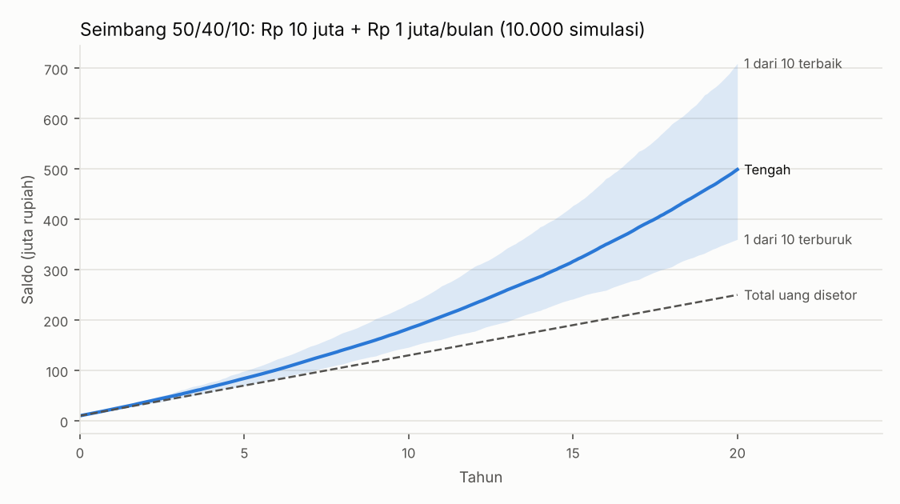
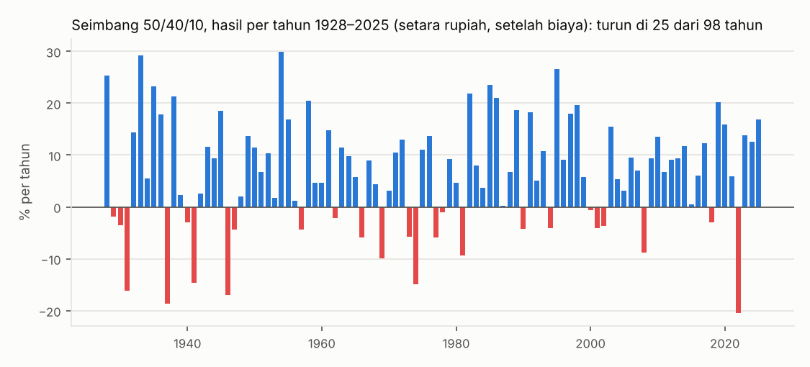

# Rencana Supaya Uang Bertambah

Pertanyaan Anda: *"intinya untung, keuangan saya bertambah; pakai compounding atau apa pun, tentukan sendiri sesuai riset terbaik, yang penting ada kalkulasi total untung per minggu/bulan."*

Dokumen ini menjawabnya dengan data. Angka dihitung ulang oleh `scripts/rencana_untung.py`; Anda bisa memasukkan modal dan setoran sendiri (bagian 6).

## Jawaban singkat

1. **Jangan mengejar untung lewat trading aktif atau memperbesar lot ("compounding" di trading).** Semua setup mentor yang kita uji tidak untung setelah biaya di data yang belum pernah dipakai, dan riset besar menunjukkan mayoritas trader ritel rugi. Compounding hanya melipatgandakan hasil rata-rata: kalau rata-ratanya rugi, compounding justru mempercepat rugi.
2. **Yang terbukti menambah uang dalam jangka panjang:** memiliki aset produktif (saham lewat reksa dana indeks/ETF), obligasi negara, dan sedikit emas, dengan biaya murah, **setor rutin tiap bulan, semua hasil diputar ulang** (inilah compounding yang benar), rebalance setahun sekali, dan ditahan minimal 10 tahun.
3. **Pilihan saya untuk Anda: portofolio Seimbang 50/40/10** — 50% saham (separuh indeks Indonesia, separuh indeks global), 40% SBN ritel, 10% emas.
4. **Hasil yang wajar:** sekitar **6,2% per tahun dalam rupiah** setelah biaya (±3,1% di atas inflasi). Dalam 10 tahun, 8 dari 10 simulasi berada di antara 2,6% dan 10,1% per tahun. Bukan 20% per tahun, dan tidak untung setiap tahun.
5. **Contoh Rp 10 juta + Rp 1 juta/bulan:** setelah 10 tahun Anda sudah menyetor Rp 130,0 juta; skenario tengah saldonya **Rp 182,5 juta** (untung Rp 52,5 juta). Peluang saldo di bawah uang yang disetor: **25% setelah 1 tahun, tetapi hanya 1,7% setelah 10 tahun.**

Ini bukan jaminan. Ini perkiraan terbaik dari data 98 tahun, dengan asumsi yang sengaja dibuat hati-hati.

## 1. Kenapa bukan trading + compounding

**Hasil uji kita sendiri.** Di [laporan backtest forex](LAPORAN_BACKTEST_FOREX.md) dan [laporan rencana cadangan](LAPORAN_RENCANA_CADANGAN.md), tidak ada setup mentor (Pola N, Ichimoku, Alvesting, Wyckoff, Ko Hengki) maupun versi perbaikannya yang lolos di data uji. Perkiraan terbaiknya sekitar impas sampai rugi setelah spread. Patokan riset (time-series momentum) hanya ±0% per tahun di forex dan +7% per tahun di kripto long saja, tetapi rugi -7,1% di periode uji akhir kripto.

**Riset besar tentang trader ritel:**

- Taiwan, seluruh day trader 1992–2006: kurang dari 1% yang bisa untung secara konsisten setelah biaya (Barber, Lee, Liu & Odean, 2014).
- Brasil, semua orang yang day trading futures indeks ≥ 300 hari: 97% rugi, dan hanya 1,1% yang menghasilkan lebih dari upah minimum (Chague, De-Losso & Giovannetti, 2020).
- Eropa: 74–89% akun ritel CFD/forex rugi (ESMA, 2018 — karena itu broker wajib menampilkan angka ini).

**Hitungan sederhananya:**

- Compounding = untung diputar lagi. Kalau rata-rata per transaksi negatif, memutar ulang membuat saldo turun lebih cepat, bukan naik.
- Rumus Kelly (ukuran taruhan terbaik secara matematis) memberi jawaban **0** kalau tidak ada keunggulan.
- Naik-turun besar menggerus hasil: +50% lalu -50% bukan impas, tetapi -25%. Leverage memperbesar efek ini.

Jadi compounding tetap dipakai, tetapi pada sesuatu yang rata-ratanya memang naik.

## 2. Apa yang terbukti menambah uang

- **Pemilik usaha mendapat bagian keuntungan.** Saham dunia 1900–2024 memberi rata-rata **5,2% per tahun di atas inflasi**, obligasi 1,7%, dan simpanan jangka pendek 0,5% (Dimson, Marsh & Staunton, UBS Global Investment Returns Yearbook 2025). Tidak setiap tahun naik, tetapi dalam jangka panjang konsisten.
- **Biaya murah menang.** Sekitar 9 dari 10 reksa dana aktif kalah dari indeksnya dalam 15 tahun (laporan SPIVA, S&P Dow Jones Indices). Alasannya sederhana: rata-rata semua pemain = pasar, dikurangi biaya (Sharpe, 1991). Pilih reksa dana indeks/ETF berbiaya rendah.
- **Diversifikasi + rebalance.** Saham, obligasi, dan emas jarang jatuh bersamaan; mengembalikan bobot setahun sekali otomatis "jual yang sudah mahal, beli yang sedang murah".
- **Perilaku lebih penting dari pilihan produk.** Investor rata-rata mendapat ±1% per tahun lebih sedikit dari reksa dananya sendiri karena masuk-keluar di waktu yang salah (Morningstar, *Mind the Gap*). Setoran otomatis dan tidak menjual saat turun menutup celah ini.
- **Setor secepatnya.** Uang sekaligus yang langsung diinvestasikan mengalahkan dicicil di ±2 dari 3 periode sejarah (Vanguard, 2012). Untuk gaji bulanan, artinya: investasikan setiap kali gajian.
- **Hasil diputar ulang.** Dividen dan kupon yang diinvestasikan kembali adalah sebagian besar dari hasil jangka panjang saham. Jangan ditarik tiap bulan.

## 3. Rencana yang saya pilih

Urutan ini penting; langkah 1–2 adalah "untung pasti" yang sering dilewatkan.

1. **Dana darurat 3–6 bulan pengeluaran** di reksa dana pasar uang (RDPU) atau tabungan. Bukan untuk investasi, supaya Anda tidak terpaksa menjual saat pasar turun.
2. **Lunasi utang berbunga tinggi dulu** (kartu kredit, paylater, pinjol: 20–100%+ per tahun). Melunasi utang 25% sama dengan untung pasti 25% per tahun — tidak ada investasi yang bisa menyamainya.
3. **Setiap gajian, setor otomatis** ke portofolio **Seimbang 50/40/10**:
   - 25% reksa dana indeks/ETF saham Indonesia (IHSG, LQ45, atau IDX30)
   - 25% reksa dana indeks/ETF saham global (S&P 500 atau MSCI World)
   - 40% SBN ritel (ORI/SR berkupon tetap, atau SBR/ST). SBN hanya dijual beberapa kali setahun: tampung dulu bagian ini di RDPU, lalu beli SBN di masa penawaran berikutnya (menurut jadwal sementara 2026: ST017, 6 November – 2 Desember 2026).
   - 10% emas (Antam/Pegadaian/bank), disimpan lama karena selisih jual-belinya 3–8%.
4. **Semua kupon, dividen, dan bunga diputar ulang** ke portofolio yang sama.
5. **Setahun sekali rebalance** ke 50/40/10. Cara paling murah: arahkan setoran baru ke bagian yang kurang, tanpa menjual.
6. **Jangan lihat saldo tiap hari dan jangan menjual saat turun.** Dalam setahun, peluang saldo di bawah uang yang disetor sekitar 25%; itu normal, bukan tanda rencananya gagal.

**Kapan memilih yang lain:**

- Uangnya dibutuhkan dalam < 3 tahun (DP rumah, biaya nikah, sekolah): jangan masuk saham. Pakai deposito, RDPU, atau SBN yang jatuh temponya sebelum tanggal itu.
- Jangka > 15 tahun dan Anda sanggup melihat saldo turun 30% tanpa menjual: Agresif 80/10/10 memberi hasil tengah lebih tinggi, tetapi peluang rugi setelah 10 tahun juga lebih besar (tabel di bagian 4).
- **Bot/trading: 0% dari uang inti.** Kalau tetap ingin belajar, batasi maksimal 5% sebagai "uang belajar" yang siap hilang, pakai mode semi-otomatis `scripts/sinyal.py` dan catat jurnalnya.

**Kenapa 50/40/10, bukan yang lain?** Bobot ini dipilih sebelum simulasi dijalankan (angka bulat standar, bukan hasil optimasi). Hasilnya: dari tiga profil, Seimbang punya peluang rugi terkecil setelah 10 tahun (1,7%, dibanding 2,6% Hati-hati dan 5,7% Agresif) dengan hasil tengah yang tetap layak — cocok dengan prioritas Anda: *yang penting untung*.

## 4. Kalkulasi untung

### Asumsi (dikunci sebelum menghitung)

| Asumsi | Nilai | Alasan |
|---|---|---|
| Data | Return tahunan AS 1928–2025 (98 tahun): saham termasuk dividen, obligasi pemerintah 10 tahun, emas, inflasi | Data publik terpanjang yang lengkap (Damodaran, NYU Stern) |
| Saham | Diturunkan 1,54% per tahun: dari 6,77% (AS) menjadi 5,20% di atas inflasi | AS pasar paling beruntung; disamakan dengan rata-rata saham dunia 1900–2024 |
| Obligasi, emas | 1,45% dan 2,49% per tahun di atas inflasi (rata-rata sejarah) | Apa adanya. Kupon SBN sekarang (6,9–7%) lebih tinggi, jadi bagian obligasi sengaja konservatif |
| Biaya dan pajak | 1% per tahun dari saldo | Biaya reksa dana, pajak kupon SBN 10%, selisih jual-beli emas |
| Inflasi Indonesia | 3% per tahun | Sasaran BI 2,5 ± 1%; September 2026: 3,28% |
| Rupiah | Hasil dihitung dalam daya beli, lalu ditambah inflasi Indonesia | Jangka panjang kurs kira-kira mengikuti selisih inflasi: 2000–2024 rupiah 0,8% per tahun lebih kuat dari perkiraan selisih inflasi, 2010–2024 rupiah 3,0% per tahun lebih lemah dari perkiraan selisih inflasi |
| Simulasi | 10.000 jalur, potongan 5 tahun berurutan dari sejarah (krisis beruntun tetap utuh), plus semua urutan tahun asli | Bootstrap blok, seed tetap |
| Setoran | Tetap tiap akhir bulan; rebalance tiap awal tahun | Sederhana dan bisa diikuti |

Varian yang dihitung: 3 profil portofolio + 2 pembanding berbunga tetap. Tidak ada yang disetel ulang setelah melihat hasil. Satu perubahan metode: pembanding deposito memakai bunga tetap, karena deposito tidak bisa rugi nominal (memakai T-bill AS + inflasi tetap membuatnya tampak rugi di tahun inflasi tinggi).

### Contoh utama: Rp 10 juta sekarang + Rp 1 juta tiap bulan, Seimbang, skenario tengah

Hasil 6,2% per tahun dalam rupiah. "Untung per bulan/minggu" adalah rata-rata selama tahun itu; kenyataannya naik-turun (lihat bagian 5).

| Tahun ke | Total disetor | Saldo akhir | Total untung | Untung per bulan (tahun itu) | Untung per minggu (tahun itu) | Saldo dalam daya beli hari ini |
|---|---|---|---|---|---|---|
| 1 | Rp 22,0 juta | Rp 23,0 juta | Rp 959 ribu | Rp 80 ribu | Rp 18 ribu | Rp 22,3 juta |
| 2 | Rp 34,0 juta | Rp 36,7 juta | Rp 2,7 juta | Rp 147 ribu | Rp 34 ribu | Rp 34,6 juta |
| 3 | Rp 46,0 juta | Rp 51,3 juta | Rp 5,3 juta | Rp 218 ribu | Rp 50 ribu | Rp 47,0 juta |
| 5 | Rp 70,0 juta | Rp 83,4 juta | Rp 13,4 juta | Rp 374 ribu | Rp 86 ribu | Rp 71,9 juta |
| 10 | Rp 130,0 juta | Rp 182,5 juta | Rp 52,5 juta | Rp 858 ribu | Rp 197 ribu | Rp 135,8 juta |
| 15 | Rp 190,0 juta | Rp 316,6 juta | Rp 126,6 juta | Rp 1,5 juta | Rp 348 ribu | Rp 203,2 juta |
| 20 | Rp 250,0 juta | Rp 497,8 juta | Rp 247,8 juta | Rp 2,4 juta | Rp 551 ribu | Rp 275,6 juta |

**Yang perlu dipahami:** di tahun pertama untungnya hanya sekitar Rp 18 ribu per minggu, jauh lebih kecil dari setoran Rp 230 ribu per minggu. Di awal, **besarnya setoran jauh lebih menentukan daripada persentase untung.** Compounding baru terasa setelah saldo besar: di tahun ke-10 untungnya sekitar Rp 858 ribu per bulan, dan di tahun ke-20 sekitar Rp 2,4 juta per bulan. Cara tercepat menambah hasil adalah menaikkan setoran setiap kali penghasilan naik.

### Rentang hasil (Seimbang, 10.000 simulasi)

| Tahun ke | Total disetor | 1 dari 10 terburuk | Tengah | 1 dari 10 terbaik | Peluang saldo < uang disetor | Terburuk dalam sejarah asli |
|---|---|---|---|---|---|---|
| 1 | Rp 22,0 juta | Rp 21,1 juta | Rp 23,1 juta | Rp 25,1 juta | 25,3% | Rp 18,8 juta |
| 3 | Rp 46,0 juta | Rp 44,8 juta | Rp 52,1 juta | Rp 59,5 juta | 18,7% | Rp 38,6 juta |
| 5 | Rp 70,0 juta | Rp 69,7 juta | Rp 84,2 juta | Rp 98,8 juta | 11,0% | Rp 62,0 juta |
| 10 | Rp 130,0 juta | Rp 146,4 juta | Rp 183,1 juta | Rp 233,0 juta | 1,7% | Rp 125,4 juta |
| 20 | Rp 250,0 juta | Rp 360,3 juta | Rp 498,9 juta | Rp 709,6 juta | 0,1% | Rp 292,9 juta |



Kolom "terburuk dalam sejarah asli" adalah hasil kalau Anda mulai di tahun terburuk sejak 1928 (misalnya tepat sebelum Depresi Besar 1929 atau krisis 2008).

### Kalau uangnya sekaligus: Rp 100 juta tanpa setoran tambahan (Seimbang)

| Tahun ke | 1 dari 10 terburuk | Tengah | 1 dari 10 terbaik | Peluang < Rp 100 juta |
|---|---|---|---|---|
| 1 | Rp 94,1 juta | Rp 107,0 juta | Rp 120,5 juta | 25,3% |
| 3 | Rp 95,9 juta | Rp 119,7 juta | Rp 149,8 juta | 13,8% |
| 5 | Rp 103,7 juta | Rp 132,8 juta | Rp 172,9 juta | 4,9% |
| 10 | Rp 129,0 juta | Rp 182,7 juta | Rp 261,3 juta | 1,1% |
| 20 | Rp 201,8 juta | Rp 329,2 juta | Rp 549,8 juta | 0,1% |

### Perbandingan setelah 10 tahun (Rp 10 juta + Rp 1 juta/bulan, total disetor Rp 130 juta)

| Pilihan | Hasil per tahun (tengah) | Saldo tengah | Saldo 1 dari 10 terburuk | Peluang rugi | Tahun terburuk |
|---|---|---|---|---|---|
| Deposito/RDPU saja (±4% bersih, tetap) | 4,0% | Rp 161,5 juta | Rp 161,5 juta | 0% | tidak pernah rugi nominal |
| SBN ritel saja (kupon ±6,9% − pajak = 6,2%, kalau kupon berikutnya sama) | 6,2% | Rp 182,4 juta | Rp 182,4 juta | 0%* | dijamin negara* |
| Hati-hati 20/70/10 | 4,9% | Rp 170,8 juta | Rp 140,6 juta | 2,6% | -19,9% (2022) |
| Seimbang 50/40/10 **(rekomendasi)** | 6,2% | Rp 183,1 juta | Rp 146,4 juta | 1,7% | -20,4% (2022) |
| Agresif 80/10/10 | 7,2% | Rp 196,3 juta | Rp 139,0 juta | 5,7% | -30,5% (1931) |
| Trading setup mentor / bot (hasil uji kita) | sekitar impas sampai rugi | – | – | – | drawdown 15–30%+ |

\* SBN dijamin negara dan tidak rugi nominal kalau dipegang sampai jatuh tempo. Tetapi kupon 6,9–7% adalah yang tertinggi sejak 2019; seri berikutnya bisa lebih rendah kalau suku bunga turun. Deposito dijamin LPS hanya sampai Rp 2 miliar per bank dan bila bunganya tidak melebihi bunga penjaminan LPS.

**Arti tabel ini:** saat ini SBN ritel memberi hasil yang hampir setara dengan skenario tengah Seimbang dengan risiko jauh lebih kecil — karena kupon SBN sedang tinggi dan model ini sengaja konservatif untuk bagian obligasi. Karena itu 40% Seimbang memang diisi SBN. Bagian saham tetap perlu untuk jangka panjang: saham dunia memberi 5,2% di atas inflasi per tahun, sedangkan kupon SBN di masa depan belum tentu setinggi sekarang.

## 5. Seperti apa naik-turunnya per minggu (data nyata 2010–2026)

Portofolio dihitung minggu per minggu dari 08 Jan 2010 sampai 30 Sep 2026 memakai return harian nyata: saham AS termasuk dividen (Kenneth French), obligasi AS 10 tahun dari imbal hasil harian (FRED), dan emas (OANDA). Dalam dolar, sebelum biaya; periode ini termasuk masa bagus saham AS, jadi hasil per tahunnya lebih tinggi dari skenario tengah di atas.

|  | Hati-hati 20/70/10 | Seimbang 50/40/10 | Agresif 80/10/10 |
|---|---|---|---|
| Minggu yang naik | 59% | 59% | 60% |
| Rata-rata per minggu | +0,10% | +0,17% | +0,25% |
| Minggu terburuk | -3,9% | -6,5% | -11,2% |
| Bulan yang naik | 66% | 68% | 67% |
| Bulan terburuk | -7,0% | -8,5% | -10,6% |
| 12 bulan terburuk | -18,5% | -19,3% | -20,1% |
| Turun terdalam dari puncak | -19,0% | -21,0% | -25,7% |
| Hasil per tahun | +5,3% | +9,0% | +12,6% |

**Contoh dengan saldo Rp 100 juta (Seimbang):** rata-rata naik Rp 173 ribu per minggu, tetapi hanya 59% minggu yang naik. Minggu terburuk turun Rp 6,5 juta, bulan terburuk Rp 8,5 juta, dan dari puncak sempat turun Rp 21,0 juta sebelum pulih. Karena itu untung dihitung per tahun, bukan per minggu.



## 6. Hitung dengan angka Anda sendiri

Ubah `modal`, `setoran_bulanan`, dan `portofolio` di `config/rencana.toml`, lalu:

```bash
python scripts/rencana_untung.py --layar
```

Atau langsung lewat perintah:

```bash
python scripts/rencana_untung.py --layar --modal 25000000 --setoran 2000000 --porto seimbang
```

Data riset diunduh sekali dengan `python -m bot.data.download riset`. Menjalankan skrip tanpa `--layar` menulis ulang laporan ini.

## 7. Batasan (jujur)

- Masa lalu bukan jaminan. Angka di atas adalah rentang yang masuk akal, bukan janji.
- Data panjang hanya tersedia untuk AS. Return saham sudah diturunkan ke rata-rata dunia, tetapi pasar Indonesia bisa lebih baik atau lebih buruk.
- Inflasi Indonesia dianggap tetap 3%. Kalau inflasi naik, angka rupiah naik tetapi daya belinya tidak.
- Tahun dengan inflasi AS tinggi (misalnya 1946 dan 2022) tampak lebih buruk dalam angka rupiah karena lonjakan inflasi AS ikut terhitung. Ini membuat angka risiko sedikit dilebih-lebihkan (lebih aman).
- Kurs rupiah tidak dimodelkan terpisah. Bagian saham global ikut naik-turun dengan kurs.
- Biaya dan pajak memakai angka kasar 1% per tahun. Pilih produk berbiaya rendah dan terdaftar OJK.
- Ini bahan pertimbangan, bukan nasihat keuangan pribadi. Cek kupon SBN dan produk terbaru sebelum membeli.

## Sumber

- Damodaran, A. *Historical Returns on Stocks, Bonds, Bills, Real Estate and Gold*, NYU Stern, pembaruan Januari 2026 — [histretSP](https://pages.stern.nyu.edu/~adamodar/New_Home_Page/datafile/histret.html).
- Dimson, E., Marsh, P. & Staunton, M. *UBS Global Investment Returns Yearbook 2025* — [ringkasan Cambridge Judge](https://www.jbs.cam.ac.uk/2025/report-stocks-have-far-outperformed-over-the-past-125-years/).
- Kenneth R. French Data Library (return harian pasar saham AS) — [situs](https://mba.tuck.dartmouth.edu/pages/faculty/ken.french/data_library.html).
- FRED: imbal hasil obligasi AS 10 tahun (DGS10), kurs USD/IDR dan IHK Indonesia (OECD).
- Barber, B., Lee, Y., Liu, Y. & Odean, T. (2014). The cross-section of speculator skill: Evidence from day trading. *Journal of Financial Markets* 18.
- Chague, F., De-Losso, R. & Giovannetti, B. (2020). Day Trading for a Living? Working paper, SSRN.
- ESMA (2018). Product intervention measures on CFDs and binary options.
- Kelly, J. L. (1956). A New Interpretation of Information Rate. *Bell System Technical Journal*.
- Sharpe, W. F. (1991). The Arithmetic of Active Management. *Financial Analysts Journal*.
- S&P Dow Jones Indices, *SPIVA Scorecards*; Morningstar, *Mind the Gap*; Vanguard (2012), *Dollar-cost averaging just means taking risk later*.
- Bank Indonesia menahan BI rate 5,75% (RDG 20–21 Oktober 2026) — [Bisnis.com](https://finansial.bisnis.com/read/20261021/11/2014413/breaking-bank-indonesia-tahan-bi-rate-575-pada-rdg-oktober-2026).
- BPS: inflasi September 2026 3,28% (yoy) — [Kontan](https://pusatdata.kontan.co.id/infografik/275/Inflasi-Tahunan-Naik-Menjadi-328-pada-September-2026).
- Kupon ORI030: 6,9% (3 tahun) dan 7,0% (6 tahun) — [Bisnis.com](https://market.bisnis.com/read/20260718/92/1988984/di-balik-larisnya-ori030-kupon-jumbo-hingga-efek-reinvestasi).
- Jadwal sementara SBN ritel 2026 — [OCBC](https://www.ocbc.id/id/article/2026/01/26/jadwal-sbn-ritel-2026-lengkap-ori-sr-st-dan-sbr-dari-januari-desember).
